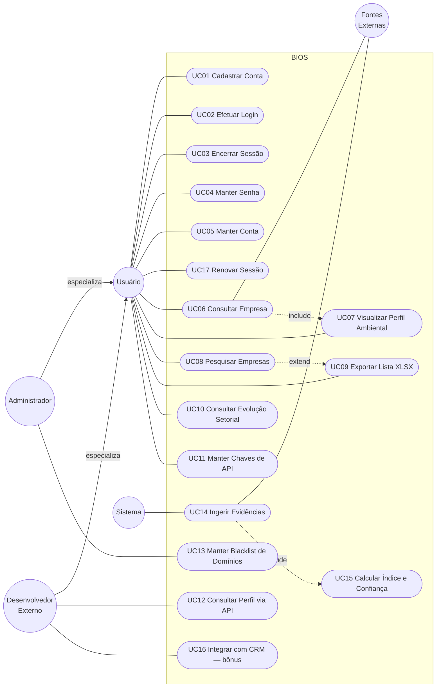
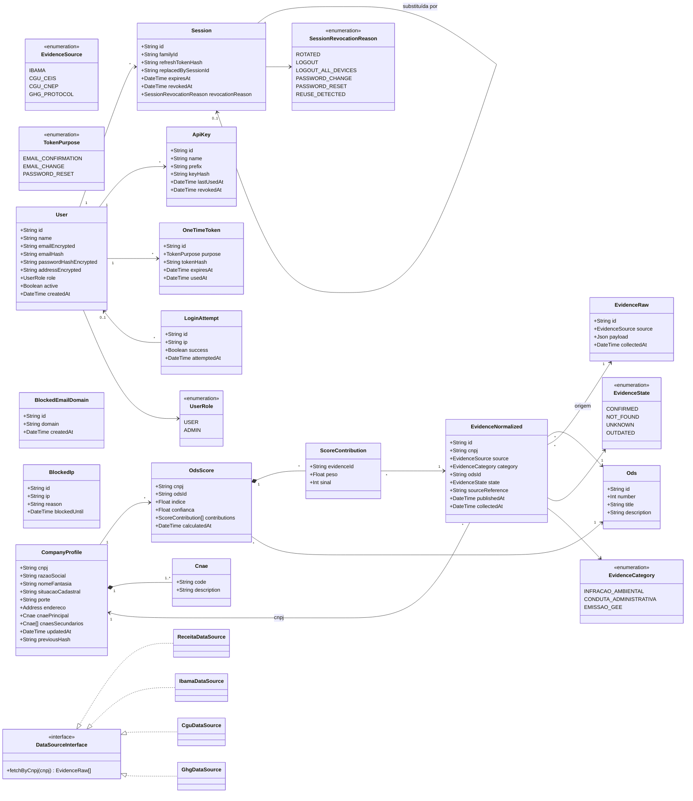
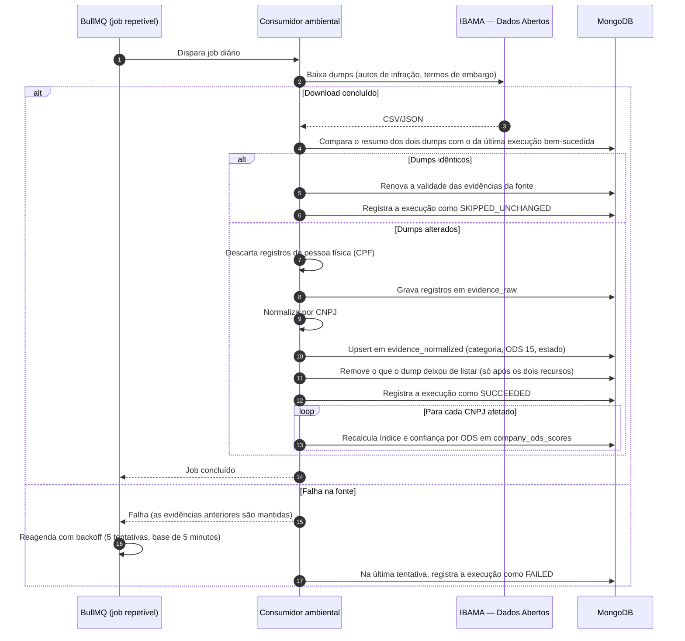
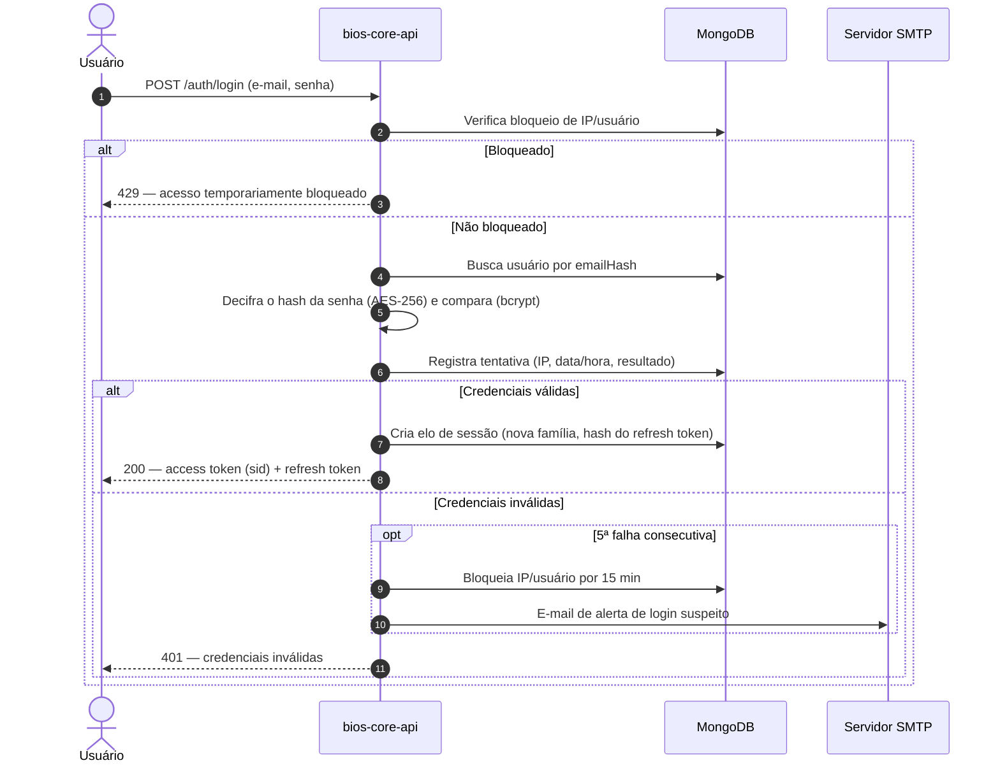
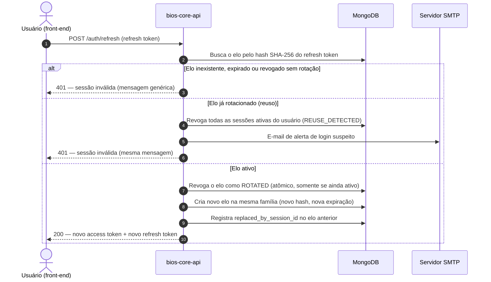
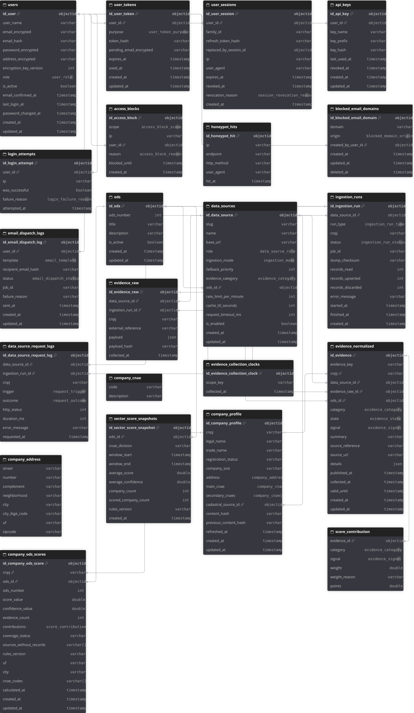
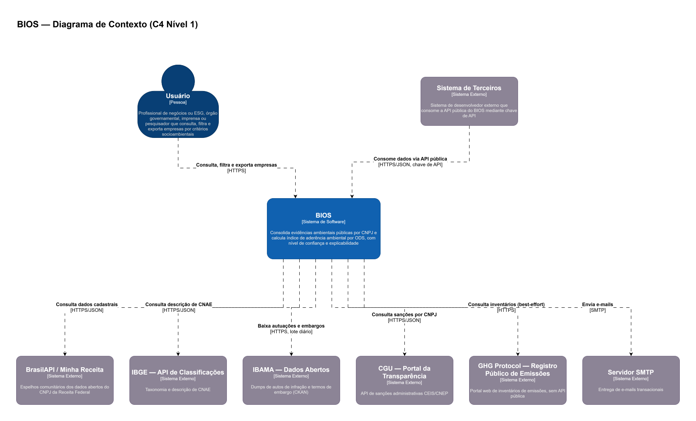
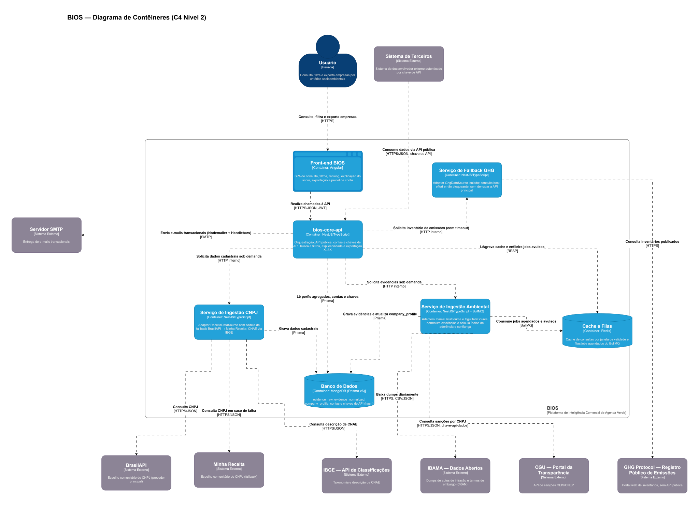

# 08. Artefatos de Análise

Esta seção apresenta os artefatos gerados pela Análise: casos de uso (diagrama e descrição),
diagrama de classes de domínio, diagramas de sequência dos fluxos principais, modelo de dados
e diagramas de arquitetura no modelo C4. Os diagramas 1 a 6 estão escritos em Mermaid,
renderizado nativamente pelo GitHub e versionado como texto junto à documentação; o modelo de
dados (diagrama 7) é gerado a partir da fonte DBML em `assets/database/bios-database.dbml.txt`;
os diagramas C4 (8 e 9) têm sua fonte editável em `assets/diagrams/bios-c4-architecture.drawio`.

Os atores referenciados são os definidos no Quadro 2 (`04-Atores-e-Histórias-dos-Usuários.md`).

## 8.1 Diagrama de Casos de Uso

O diagrama 1 representa os casos de uso do sistema BIOS. O Administrador é uma especialização
do Usuário (mesma entidade, com papel `ADMIN`) e herda todos os seus casos de uso; o
Desenvolvedor Externo é um Usuário atuando via API.

<p align="center"><b>Diagrama 1 - Casos de Uso</b></p>



O honeypot ([RF21]) e o bloqueio de IP não aparecem como casos de uso porque não atendem a
nenhum ator legítimo: são mecanismos de defesa, descritos em `06-Requisitos-Nao-Funcionais.md`
([NFSE07]) e no fluxo alternativo do UC02.

## 8.2 Descrição dos Casos de Uso

Esta seção descreve todos os casos de uso do diagrama 1.

<table>
    <tr>
        <td><b>Nome:</b> UC01 — Cadastrar Conta.</td>
        <td colspan="2"><b>Objetivo/Descrição:</b> Permitir que uma pessoa crie uma conta e a ative por confirmação de e-mail. ([RF01], [RF22], [RF28], [RF18])</td>
    </tr>
    <tr>
        <td><b>Ator(es):</b> Usuário.</td>
        <td><b>Ator(es) Secundário(s):</b> Sistema.</td>
    </tr>
    <tr>
        <td colspan="2"><b>Pré-condições:</b> A pessoa não deve possuir conta ativa com o mesmo e-mail.</td>
    </tr>
	<tr>
        <td colspan="2"><b>Fluxo Normal:</b>
		<br>1 - O usuário acessa a tela de cadastro e informa nome, e-mail e senha.</br>
		<br>2 - O sistema valida os dados e verifica se o domínio do e-mail consta na blacklist.</br>
		<br>3 - O sistema cria a conta com estado inativo e papel <code>USER</code>, criptografando os dados sensíveis.</br>
		<br>4 - O sistema envia e-mail transacional com link de confirmação.</br>
		<br>5 - O usuário acessa o link de confirmação.</br>
		<br>6 - O sistema valida o token e ativa a conta.</br>
		<br>7 - Este caso de uso finaliza aqui.</br></td></tr>
	<tr>
        <td colspan="2"><b>Fluxos Alternativos:</b>
		<br>2.1 - O domínio do e-mail consta na blacklist: o sistema recusa o cadastro com mensagem genérica e volta a 1.</br>
		<br>2.2 - O e-mail já está cadastrado: o sistema exibe a mesma mensagem genérica de sucesso, sem revelar a existência da conta, e não envia novo e-mail de confirmação.</br>
		<br>6.1 - O token está expirado ou já foi usado: o sistema exibe erro e oferece o reenvio do link.</br></td></tr>
	<tr>
        <td colspan="2"><b>Pós-condições:</b> Conta ativa, apta a efetuar login (UC02).</td></tr>
	<tr>
        <td colspan="2"><b>Regras de Negócio:</b>
		<br>1 - Contas não confirmadas não podem efetuar login.</br>
		<br>2 - O token de confirmação é de uso único e tem validade limitada (24 horas por padrão, configurável); solicitar um novo link invalida o anterior.</br>
		<br>3 - E-mail e endereço são armazenados com AES-256; a senha recebe duas camadas — hash bcrypt, cifrado em seguida com AES-256 ([NFSE03]).</br>
			<br>4 - A senha tem de 8 a 128 caracteres, com ao menos uma letra e um número; o nome tem de 2 a 100 caracteres.</br>
			<br>5 - O e-mail é normalizado (minúsculas, sem espaços nas bordas) antes da verificação de unicidade, de modo que variações de caixa não geram contas distintas.</br>
			<br>6 - A resposta do cadastro e a do reenvio do link são idênticas para um e-mail novo e para um já cadastrado, para que não sirvam de consulta de contas existentes. No cadastro, o hash da senha é calculado antes de se saber se o e-mail existe, o que iguala também o tempo de resposta; no reenvio, o tempo não é igualado, e a diferença (uma gravação e um enfileiramento) é um limite conhecido.</br></td></tr>
</table>

<br></br>

<table>
    <tr>
        <td><b>Nome:</b> UC02 — Efetuar Login.</td>
        <td colspan="2"><b>Objetivo/Descrição:</b> Permitir autenticação e identificação de usuários. ([RF02], [RF19], [RF20], [RF18])</td>
    </tr>
    <tr>
        <td><b>Ator(es):</b> Usuário.</td>
        <td><b>Ator(es) Secundário(s):</b> Sistema.</td>
    </tr>
    <tr>
        <td colspan="2"><b>Pré-condições:</b> O usuário deve possuir conta ativa (UC01).</td>
    </tr>
	<tr>
        <td colspan="2"><b>Fluxo Normal:</b>
		<br>1 - O usuário acessa a tela de login e informa e-mail e senha.</br>
		<br>2 - O sistema verifica se o IP e o usuário não estão bloqueados.</br>
		<br>3 - O sistema valida as credenciais e registra a tentativa (IP, data/hora, resultado).</br>
		<br>4 - O sistema abre uma nova família de sessão e emite um access token JWT de vida curta (com o <code>sid</code> da sessão) e um refresh token opaco de uso único, persistindo apenas o hash do refresh token.</br>
		<br>5 - Exibe a tela principal do sistema de acordo com o papel.</br>
		<br>6 - Este caso de uso finaliza aqui.</br></td></tr>
	<tr>
        <td colspan="2"><b>Fluxos Alternativos:</b>
		<br>2.1 - IP ou usuário bloqueado: o sistema recusa a tentativa, informa que o acesso está temporariamente bloqueado e encerra o caso de uso.</br>
		<br>3.1 - Credenciais inválidas: o sistema registra a falha e exibe mensagem genérica de credenciais inválidas.</br>
		<br>3.2 - Quinta falha consecutiva: o sistema bloqueia IP e/ou usuário por 15 minutos e envia e-mail de alerta de login suspeito ao titular da conta.</br>
		<br>3.3 - Volta a 1.</br>
			<br>3.4 - A senha confere, mas o e-mail da conta ainda não foi confirmado: o sistema registra a tentativa, informa que é preciso confirmar o e-mail, oferece o reenvio do link (UC01, fluxo 6.1) e volta a 1.</br></td></tr>
	<tr>
        <td colspan="2"><b>Pós-condições:</b> Sessão ativa de acordo com o papel do usuário, renovável por UC17.</td></tr>
	<tr>
        <td colspan="2"><b>Regras de Negócio:</b>
		<br>1 - Somente contas ativas podem se autenticar.</br>
		<br>2 - 5 tentativas consecutivas malsucedidas resultam em bloqueio de 15 minutos ([NFSE06]).</br>
		<br>3 - A mensagem de erro não distingue e-mail inexistente de senha incorreta.</br>
		<br>4 - Cada login corresponde a um dispositivo: abre uma família de sessão própria, independente das demais sessões do usuário.</br>
			<br>5 - A contagem de falhas consecutivas é feita por IP e por usuário, e o primeiro a chegar a 5 é bloqueado. Um login bem-sucedido zera a contagem, e o início de um bloqueio também: as falhas que o causaram não contam de novo. Tentativas recusadas por bloqueio ou por conta não confirmada não contam como falha de senha.</br>
			<br>6 - Enquanto durar o bloqueio, nem a senha correta permite o acesso, e a resposta informa o tempo restante.</br>
			<br>7 - O e-mail de alerta de login suspeito é enviado apenas quando o bloqueio é da conta; falhas contra e-mails sem conta bloqueiam apenas o IP.</br>
			<br>8 - Não distinguir e-mail inexistente de senha incorreta vale também para o tempo de resposta: sem conta, a senha é conferida contra um hash descartável.</br></td></tr>
</table>

<br></br>

<table>
    <tr>
        <td><b>Nome:</b> UC03 — Encerrar Sessão.</td>
        <td colspan="2"><b>Objetivo/Descrição:</b> Permitir que o usuário encerre a sessão do dispositivo atual ou de todos os seus dispositivos. ([RF23])</td>
    </tr>
    <tr>
        <td><b>Ator(es):</b> Usuário.</td>
        <td><b>Ator(es) Secundário(s):</b> Não há.</td>
    </tr>
    <tr>
        <td colspan="2"><b>Pré-condições:</b> O usuário deve estar com sessão ativa.</td>
    </tr>
	<tr>
        <td colspan="2"><b>Fluxo Normal:</b>
		<br>1 - O usuário seleciona a opção sair.</br>
		<br>2 - O sistema identifica a sessão atual pelo <code>sid</code> do access token e revoga toda a família de rotação dessa sessão (LOGOUT).</br>
		<br>3 - Exibe a tela de login.</br>
		<br>4 - Este caso de uso finaliza aqui.</br></td></tr>
	<tr>
        <td colspan="2"><b>Fluxos Alternativos:</b>
		<br>1.1 - Sair de todos os dispositivos: o sistema revoga todas as sessões ativas do usuário (LOGOUT_ALL_DEVICES). Vai para 3.</br></td></tr>
	<tr>
        <td colspan="2"><b>Pós-condições:</b> Nem o access token nem o refresh token das sessões encerradas são aceitos em qualquer requisição posterior.</td></tr>
	<tr>
        <td colspan="2"><b>Regras de Negócio:</b>
		<br>1 - O access token é validado contra a sessão a cada requisição; a revogação tem efeito imediato, sem aguardar a expiração do token ([NFSE05]).</br>
		<br>2 - Encerrar a sessão de um dispositivo não afeta as sessões dos demais.</br>
			<br>3 - Encerrar a sessão de um dispositivo revoga toda a sua família de rotação (inclusive o refresh token vigente), de modo que nem o access token nem o refresh token continuam válidos; não há lista de tokens revogados.</br>
			<br>4 - Toda funcionalidade exige sessão ativa por padrão; apenas as de acesso anônimo (cadastro, confirmação de e-mail, login, renovação de sessão, recuperação de senha e health check) são públicas.</br>
			<br>5 - Requisições sem sessão válida — token ausente, adulterado, expirado ou de sessão encerrada — recebem a mesma resposta de não autenticado.</br></td></tr>
</table>

<br></br>

<table>
    <tr>
        <td><b>Nome:</b> UC04 — Manter Senha.</td>
        <td colspan="2"><b>Objetivo/Descrição:</b> Permitir alterar a senha (autenticado) ou recuperá-la quando esquecida (não autenticado). ([RF24], [RF25], [RF18])</td>
    </tr>
    <tr>
        <td><b>Ator(es):</b> Usuário.</td>
        <td><b>Ator(es) Secundário(s):</b> Sistema.</td>
    </tr>
    <tr>
        <td colspan="2"><b>Pré-condições:</b> O usuário deve possuir conta ativa.</td>
    </tr>
	<tr>
        <td colspan="2"><b>Fluxo Normal (alteração):</b>
		<br>1 - O usuário autenticado acessa a opção alterar senha.</br>
		<br>2 - Informa a senha atual e a nova senha.</br>
		<br>3 - O sistema valida a senha atual e grava a nova.</br>
		<br>4 - O sistema revoga todas as sessões ativas do usuário.</br>
		<br>5 - Exibe a tela de login.</br>
		<br>6 - Este caso de uso finaliza aqui.</br></td></tr>
	<tr>
        <td colspan="2"><b>Fluxos Alternativos:</b>
		<br>1.1 - Recuperação: o usuário não autenticado informa o e-mail na tela de recuperação.</br>
		<br>1.2 - O sistema envia, se o e-mail existir, um link com token de uso único e validade limitada, exibindo sempre a mesma mensagem de confirmação.</br>
		<br>1.3 - O usuário acessa o link e informa a nova senha; o sistema valida o token, grava a senha e revoga as sessões ativas. Vai para 5.</br>
		<br>3.1 - Senha atual incorreta: o sistema exibe erro e volta a 2.</br></td></tr>
	<tr>
        <td colspan="2"><b>Pós-condições:</b> Nova senha em vigor e nenhuma sessão anterior ativa.</td></tr>
	<tr>
        <td colspan="2"><b>Regras de Negócio:</b>
		<br>1 - O token de recuperação é de uso único e tem validade limitada (2 horas por padrão, configurável); solicitar um novo link invalida o anterior.</br>
		<br>2 - A tela de recuperação não revela se o e-mail informado está cadastrado.</br>
			<br>3 - A nova senha obedece à mesma política do cadastro (8 a 128 caracteres, com ao menos uma letra e um número) e, na alteração, deve ser diferente da atual.</br>
			<br>4 - Somente contas ativas recebem o link de recuperação; a conta ainda não confirmada precisa confirmar o e-mail (UC01).</br>
			<br>5 - A alteração e a recuperação revogam as sessões ativas de todos os dispositivos do usuário, inclusive a que originou o pedido; a nova senha é gravada antes da revogação, para que a senha antiga não possa abrir uma sessão nova no intervalo.</br>
			<br>6 - Uma nova senha inválida (política) não consome o link de recuperação; um link já usado, expirado ou de outra finalidade é recusado.</br>
			<br>7 - Ao gravar a nova senha, os campos cifrados da conta (e-mail e endereço) são migrados para a chave de criptografia ativa quando o documento ainda usa uma versão anterior, pois a conta registra uma única versão de chave.</br></td></tr>
</table>

<br></br>

<table>
    <tr>
        <td><b>Nome:</b> UC05 — Manter Conta.</td>
        <td colspan="2"><b>Objetivo/Descrição:</b> Permitir que o usuário edite seus dados de conta ou exclua a própria conta. ([RF26], [RF27], [RF28])</td>
    </tr>
    <tr>
        <td><b>Ator(es):</b> Usuário.</td>
        <td><b>Ator(es) Secundário(s):</b> Sistema.</td>
    </tr>
    <tr>
        <td colspan="2"><b>Pré-condições:</b> O usuário deve estar com sessão ativa.</td>
    </tr>
	<tr>
        <td colspan="2"><b>Fluxo Normal (edição):</b>
		<br>1 - O usuário acessa o painel de conta e edita nome e/ou endereço.</br>
		<br>2 - O sistema valida e grava os dados criptografados.</br>
		<br>3 - Exibe sucesso.</br>
		<br>4 - Este caso de uso finaliza aqui.</br></td></tr>
	<tr>
        <td colspan="2"><b>Fluxos Alternativos:</b>
		<br>1.1 - Alteração de e-mail: o sistema envia confirmação ao novo endereço e só efetiva a troca após a confirmação ([RF28]).</br>
		<br>1.2 - Exclusão: o usuário seleciona excluir conta e confirma com a senha.</br>
		<br>1.3 - O sistema remove os dados pessoais, revoga todas as chaves de API e encerra todas as sessões. Exibe a tela inicial e finaliza o caso de uso.</br></td></tr>
	<tr>
        <td colspan="2"><b>Pós-condições:</b> Dados atualizados; ou, na exclusão, nenhum dado pessoal do titular mantido e nenhuma credencial (sessão ou chave) válida.</td></tr>
	<tr>
        <td colspan="2"><b>Regras de Negócio:</b>
		<br>1 - A exclusão atende ao direito de eliminação do titular previsto na LGPD ([NFSE02]).</br>
		<br>2 - Registros de tentativa de login associados à conta excluída mantêm apenas IP e data/hora, desvinculados do titular.</br>
			<br>3 - O endereço é composto por CEP, logradouro, número, complemento (opcional), bairro, cidade e unidade da federação; é guardado serializado e cifrado com AES-256 ([NFSE03]), e pode ser removido da conta.</br>
			<br>4 - A alteração de e-mail exige a senha atual. O link de confirmação é enviado ao novo endereço, tem as mesmas regras do link de confirmação de cadastro (uso único, 24 horas por padrão) e o e-mail atual vale até que ele seja aberto; pedir outra troca invalida o link anterior.</br>
			<br>5 - O novo e-mail é verificado contra a blacklist de domínios ([RF22]). Se ele já pertencer a outra conta, o pedido recebe a mesma resposta do sucesso e nada é enviado, para não revelar contas existentes; se passar a pertencer a outra conta antes da confirmação, a troca é recusada.</br>
			<br>6 - A exclusão exige a senha e remove a conta, as sessões, os tokens, as chaves de API, os bloqueios e os registros de e-mails enviados ao titular; não há remoção lógica. A sessão usada no pedido deixa de valer imediatamente.</br>
			<br>7 - Ao gravar qualquer campo cifrado, os demais campos cifrados da conta são migrados para a chave de criptografia ativa quando o documento ainda usa uma versão anterior (ver UC04, regra 7); o e-mail pendente de uma troca guarda a versão da chave que o cifrou.</br></td></tr>
</table>

<br></br>

<table>
    <tr>
        <td><b>Nome:</b> UC06 — Consultar Empresa.</td>
        <td colspan="2"><b>Objetivo/Descrição:</b> Permitir localizar uma empresa por CNPJ ou por razão social/nome fantasia e exibir seus dados cadastrais. ([RF03], [RF04], [RF05], [RF06])</td>
    </tr>
    <tr>
        <td><b>Ator(es):</b> Usuário.</td>
        <td><b>Ator(es) Secundário(s):</b> Fontes Externas (Receita Federal via BrasilAPI/OpenCNPJ/Minha Receita, IBGE).</td>
    </tr>
    <tr>
        <td colspan="2"><b>Pré-condições:</b> O usuário deve estar com sessão ativa.</td>
    </tr>
	<tr>
        <td colspan="2"><b>Fluxo Normal:</b>
		<br>1 - O usuário informa um CNPJ no campo de busca.</br>
		<br>2 - O sistema valida o formato e os dígitos verificadores do CNPJ.</br>
		<br>3 - O sistema busca o perfil em cache; se ausente ou vencido, consulta a BrasilAPI.</br>
		<br>4 - O sistema exibe razão social, situação cadastral, porte, endereço e CNAE principal e secundários com descrição.</br>
		<br>5 - Inclui UC07 (Visualizar Perfil Ambiental).</br>
		<br>6 - Este caso de uso finaliza aqui.</br></td></tr>
	<tr>
        <td colspan="2"><b>Fluxos Alternativos:</b>
		<br>1.1 - Busca por nome: o usuário informa razão social ou nome fantasia; o sistema lista as empresas da base local por aproximação; o usuário seleciona uma e vai para 4.</br>
		<br>2.1 - CNPJ inválido: o sistema exibe erro de validação e volta a 1.</br>
		<br>3.1 - BrasilAPI indisponível ou sem retorno: o sistema consulta o OpenCNPJ; persistindo a falha, consulta a Minha Receita (fallback final).</br>
		<br>3.2 - Os três provedores indisponíveis e sem cache: o sistema informa indisponibilidade temporária dos dados cadastrais.</br>
		<br>3.3 - CNPJ inexistente: o sistema informa que a empresa não foi encontrada.</br></td></tr>
	<tr>
        <td colspan="2"><b>Pós-condições:</b> Perfil cadastral da empresa exibido e armazenado em cache.</td></tr>
	<tr>
        <td colspan="2"><b>Regras de Negócio:</b>
		<br>1 - Nenhum dado pessoal de sócios ou administradores é exibido ou armazenado ([INL02]).</br>
		<br>2 - A busca por nome opera apenas sobre empresas já presentes na base local, pois nenhuma das fontes cadastrais oferece busca por nome.</br>
		<br>3 - Consultas em cache devem responder em até 2 segundos ([NFDE02]).</br>
			<br>4 - A consulta não fala com os provedores cadastrais: ela publica um job na fila <code>company-profile</code> e aguarda, com prazo, o consumidor da fila percorrer a cadeia de fallback e gravar o perfil. O consumidor responde <code>FOUND</code>, <code>NOT_FOUND</code> (fluxo 3.3) ou <code>SOURCES_UNAVAILABLE</code> (fluxo 3.2).</br>
			<br>5 - A ordem de resolução é cache, banco e fila. Um cadastro guardado dentro da janela de validade da fonte que o respondeu (<code>data_sources.cache_ttl_seconds</code>) é servido sem nova consulta externa e volta ao cache.</br>
			<br>6 - Com os provedores indisponíveis, o cadastro guardado é servido mesmo vencido (degradação graciosa, [NFCO01]) e não volta ao cache; sem cadastro guardado, a resposta é de indisponibilidade temporária, distinta de "empresa não encontrada".</br>
			<br>7 - Consultas simultâneas do mesmo CNPJ, e as repetidas em até 60 segundos, compartilham um único job e o seu resultado, o que respeita o limite de requisições das fontes ([NFPD01]).</br>
			<br>8 - O CNPJ é validado pelo formato e pelos dígitos verificadores, e pode ser numérico ou alfanumérico (formato adotado pela Receita Federal a partir de julho de 2026); é normalizado (sem pontuação, em maiúsculas) antes de ser usado em cache, fila e banco.</br>
			<br>9 - Os provedores são consultados um por vez, na ordem de prioridade do catálogo de fontes (BrasilAPI, OpenCNPJ, Minha Receita); o seguinte só é consultado quando o anterior não serve, o que inclui "não encontrado", pois os espelhos da Receita se atualizam em ritmos diferentes. A empresa só é dada como não encontrada quando todos os provedores consultados dizem isso; se algum não pôde responder, a resposta é de indisponibilidade.</br>
			<br>10 - A descrição de cada atividade econômica (CNAE) é a oficial do IBGE, para a mesma atividade ter o mesmo texto qualquer que seja o provedor; sem ela, vale a do provedor.</br>
			<br>11 - A razão social e o nome fantasia de empresário individual e de MEI costumam trazer o CPF do titular ao lado do nome; o CPF (sequência de 11 dígitos) é mascarado antes de ser armazenado ou exibido ([INL02]).</br>
			<br>12 - A busca por nome casa por início de palavra: a empresa entra quando cada palavra digitada começa alguma palavra da razão social ou do nome fantasia, em qualquer ordem; caixa, acentos e pontuação são ignorados. O texto tem até 100 caracteres e precisa de ao menos uma palavra com 3 caracteres ou mais, para a busca não varrer a base inteira.</br>
			<br>13 - Os resultados vêm paginados, primeiro os que começam pela frase digitada e depois os demais, com desempate pela razão social e pelo CNPJ (paginação estável). A busca não chama provedor nem publica job; nenhum resultado é uma resposta válida, e não "empresa não encontrada". Como a razão social guardada já tem o CPF mascarado (regra 11), digitar um CPF não encontra o titular ([INL02]).</br></td></tr>
</table>

<br></br>

<table>
    <tr>
        <td><b>Nome:</b> UC07 — Visualizar Perfil Ambiental.</td>
        <td colspan="2"><b>Objetivo/Descrição:</b> Exibir as evidências da empresa e, para cada ODS (13 e 15), o índice de aderência, o nível de confiança e a explicação do score. ([RF07], [RF08], [RF09], [RF10], [RF11], [RF12])</td>
    </tr>
    <tr>
        <td><b>Ator(es):</b> Usuário.</td>
        <td><b>Ator(es) Secundário(s):</b> Fontes Externas (CGU, GHG Protocol).</td>
    </tr>
    <tr>
        <td colspan="2"><b>Pré-condições:</b> Empresa localizada via UC06.</td>
    </tr>
	<tr>
        <td colspan="2"><b>Fluxo Normal:</b>
		<br>1 - O sistema confirma a existência de um perfil cadastral local para o CNPJ antes de ler evidências ou iniciar coletas. Sem perfil, responde 404 sem gravar nem publicar jobs. Com perfil, recupera as evidências da empresa: IBAMA a partir do índice local do lote diário; CEIS/CNEP e GHG Protocol a partir de persistência válida, cache ou consulta sob demanda. A leitura local e as solicitações CGU/GHG são iniciadas em paralelo; a CGU usa a fila ambiental e o GHG sua fila exclusiva, ambas com espera limitada. A rota de evidências limita a 20 consultas por minuto por IP, além do limite global.</br>
		<br>2 - O sistema exibe as evidências agrupadas por categoria, com fonte, estado, data de publicação, data de coleta, validade e link ou referência da fonte original. Na resposta consolidada, somente <code>CONFIRMED</code> traz sinal positivo/negativo; <code>NOT_FOUND</code>, <code>UNKNOWN</code> e <code>OUTDATED</code> trazem sinal nulo, sem alterar o histórico persistido.</br>
		<br>3 - O sistema exibe, para cada ODS, o índice de aderência e o nível de confiança, lado a lado e nunca combinados.</br>
		<br>4 - O usuário seleciona a explicação do score de um ODS.</br>
		<br>5 - O sistema lista as evidências que compuseram o índice, com peso e sinal (positivo/negativo).</br>
		<br>6 - Este caso de uso finaliza aqui.</br></td></tr>
	<tr>
        <td colspan="2"><b>Fluxos Alternativos:</b>
		<br>1.1 - CNPJ sem resposta no índice local do IBAMA: se há lote completo ainda válido, concluído ou reconfirmado sem alteração, o sistema confirma <code>NOT_FOUND</code> com a data e a validade desse lote, sem novo download. Sem lote válido, enfileira um job avulso para o CNPJ (UC14) na fila própria do IBAMA, sem aguardar a conclusão, e mantém <code>UNKNOWN</code> enquanto a coleta está pendente. Essa fila processa um download de dumps por vez e reaproveita os dumps baixados por alguns minutos, de modo que vários CNPJs distintos não façam um download cada nem atrasem as consultas à CGU. Respostas anteriores vencidas são preservadas como <code>OUTDATED</code> durante a atualização.</br>
		<br>1.2 - CGU ou GHG Protocol indisponível (ou timeout do serviço de fallback GHG): o sistema exibe as evidências das demais fontes. Sem credencial CGU configurada, a API continua disponível e CEIS/CNEP ficam <code>UNKNOWN</code> sem nova consulta externa; o health check informa a ausência sem retornar falha geral. Sem resposta anterior da fonte afetada, registra <code>UNKNOWN</code>; uma resposta anterior é preservada e passa a <code>OUTDATED</code> quando vence ([NFCO01]). CEIS e CNEP são tratados separadamente; falha em uma página não confirma ausência nem substitui a coleta anterior.</br></td></tr>
	<tr>
        <td colspan="2"><b>Pós-condições:</b> Perfil ambiental exibido com rastreabilidade até a fonte de cada evidência. A resposta informa o nome público da fonte e preserva seu identificador ou link original, inclusive o recurso oficial quando não há link individual. URLs informadas devem ser absolutas HTTPS e não carregar credenciais. Uma evidência sem identificador não vazio nem link válido não é exibida como confirmada: aparece como <code>UNKNOWN</code>, sem sinal, resumo ou detalhes confirmatórios, preservando o histórico e as datas no banco. Nenhum link é inventado.</td></tr>
	<tr>
        <td colspan="2"><b>Regras de Negócio:</b>
		<br>1 - O sistema nunca afirma que a empresa "é" ou "não é" sustentável ([IND01]).</br>
		<br>2 - <code>UNKNOWN</code> nunca é apresentado nem pontuado como evidência negativa ([IND02]).</br>
		<br>3 - Sanções do CEIS/CNEP são exibidas como conduta administrativa, nunca como infração ambiental. A consulta lê todas as páginas antes de substituir o retrato da fonte para o CNPJ; resposta completa sem registros confirma <code>NOT_FOUND</code>, sem bônus no índice. Sanções ainda retornadas pela fonte com data final vencida são preservadas como registros históricos confirmados, com suas datas explícitas; isso não afirma vigência jurídica. O reaproveitamento do cache mantém a data e a validade da coleta original.</br>
		<br>4 - Os índices dos ODS 13 e 15 não são comparáveis entre si e não são combinados em índice geral.</br>
        <br>5 - O GHG é coletado somente pelo consumidor da fila própria <code>ghg-inventory</code>, com prazo do catálogo. O cadastro de organizações do portal é sincronizado uma vez por dia, em segundo plano, e a coleta de cada CNPJ o lê já sincronizado: não há chamada externa para localizar candidatos, e empresa sem organização no cadastro não faz nenhuma chamada. O nome cadastral localiza candidatos, mas apenas CNPJ exato e ano inventariado do relatório público confirmam a evidência positiva de publicação do inventário mais recente. Sem correspondência verificável, sem inventário ou em falha, o resultado é <code>UNKNOWN</code>, nunca <code>NOT_FOUND</code>; respostas anteriores são preservadas. Coleta válida é reutilizada sem renovar artificialmente suas datas. O ano do inventário não é data de publicação, que permanece nula quando ausente. Não são armazenados contatos nem texto integral do PDF ([INL02]).</br></td></tr>
</table>

<br></br>

<table>
    <tr>
        <td><b>Nome:</b> UC08 — Pesquisar Empresas.</td>
        <td colspan="2"><b>Objetivo/Descrição:</b> Permitir filtrar e ordenar empresas da base por critérios cadastrais e socioambientais. ([RF13], [RF14])</td>
    </tr>
    <tr>
        <td><b>Ator(es):</b> Usuário.</td>
        <td><b>Ator(es) Secundário(s):</b> Não há.</td>
    </tr>
    <tr>
        <td colspan="2"><b>Pré-condições:</b> O usuário deve estar com sessão ativa.</td>
    </tr>
	<tr>
        <td colspan="2"><b>Fluxo Normal:</b>
		<br>1 - O usuário acessa a tela de pesquisa.</br>
		<br>2 - Informa filtros de CNAE, UF e/ou município.</br>
		<br>3 - Seleciona um ODS e, opcionalmente, índice mínimo e confiança mínima para esse ODS.</br>
		<br>4 - Escolhe a ordenação pelo índice do ODS selecionado (ascendente ou descendente).</br>
		<br>5 - O sistema exibe a lista paginada de empresas.</br>
		<br>6 - Este caso de uso finaliza aqui.</br></td></tr>
	<tr>
        <td colspan="2"><b>Fluxos Alternativos:</b>
		<br>5.1 - Nenhum resultado: o sistema informa que nenhuma empresa atende aos filtros.</br>
		<br>5.2 - O usuário seleciona exportar: estende para UC09.</br></td></tr>
	<tr>
        <td colspan="2"><b>Pós-condições:</b> Lista filtrada exibida.</td></tr>
	<tr>
        <td colspan="2"><b>Regras de Negócio:</b>
		<br>1 - A pesquisa opera apenas sobre empresas já presentes em <code>company_profile</code>.</br>
		<br>2 - Filtros de índice, confiança e ordenação sempre se referem a um único ODS selecionado.</br></td></tr>
</table>

<br></br>

<table>
    <tr>
        <td><b>Nome:</b> UC09 — Exportar Lista XLSX.</td>
        <td colspan="2"><b>Objetivo/Descrição:</b> Permitir exportar a lista resultante de uma pesquisa em formato XLSX. ([RF15])</td>
    </tr>
    <tr>
        <td><b>Ator(es):</b> Usuário.</td>
        <td><b>Ator(es) Secundário(s):</b> Não há.</td>
    </tr>
    <tr>
        <td colspan="2"><b>Pré-condições:</b> Pesquisa realizada via UC08 com ao menos um resultado.</td>
    </tr>
	<tr>
        <td colspan="2"><b>Fluxo Normal:</b>
		<br>1 - O usuário seleciona exportar na tela de resultados.</br>
		<br>2 - O sistema gera o arquivo com os mesmos filtros e ordenação aplicados.</br>
		<br>3 - O navegador inicia o download do arquivo.</br>
		<br>4 - Este caso de uso finaliza aqui.</br></td></tr>
	<tr>
        <td colspan="2"><b>Fluxos Alternativos:</b> Não há.</td></tr>
	<tr>
        <td colspan="2"><b>Pós-condições:</b> Arquivo XLSX entregue ao usuário.</td></tr>
	<tr>
        <td colspan="2"><b>Regras de Negócio:</b>
		<br>1 - O arquivo contém dados cadastrais da pessoa jurídica e, em colunas separadas por ODS, índice e nível de confiança.</br>
		<br>2 - O arquivo não contém nenhum dado pessoal ou de contato de indivíduo ([INL02]).</br></td></tr>
</table>

<br></br>

<table>
    <tr>
        <td><b>Nome:</b> UC10 — Consultar Evolução Setorial.</td>
        <td colspan="2"><b>Objetivo/Descrição:</b> Exibir a evolução do índice médio de cada ODS por setor (CNAE) ao longo do tempo. ([RF30]; prioridade Desejável)</td>
    </tr>
    <tr>
        <td><b>Ator(es):</b> Usuário.</td>
        <td><b>Ator(es) Secundário(s):</b> Não há.</td>
    </tr>
    <tr>
        <td colspan="2"><b>Pré-condições:</b> O usuário deve estar com sessão ativa; a série histórica de scores deve estar disponível (ver <code>15-Impacto-Ambiental.md</code>, seção 15.4).</td>
    </tr>
	<tr>
        <td colspan="2"><b>Fluxo Normal:</b>
		<br>1 - O usuário seleciona um CNAE e um ODS.</br>
		<br>2 - O sistema exibe o índice médio do setor por janela de tempo.</br>
		<br>3 - Este caso de uso finaliza aqui.</br></td></tr>
	<tr>
        <td colspan="2"><b>Fluxos Alternativos:</b>
		<br>2.1 - Histórico insuficiente: o sistema informa que ainda não há janelas suficientes para o setor.</br></td></tr>
	<tr>
        <td colspan="2"><b>Pós-condições:</b> Evolução setorial exibida.</td></tr>
	<tr>
        <td colspan="2"><b>Regras de Negócio:</b> A evolução é sempre agregada por setor, nunca exibida por empresa individual ([IA05]).</td></tr>
</table>

<br></br>

<table>
    <tr>
        <td><b>Nome:</b> UC11 — Manter Chaves de API.</td>
        <td colspan="2"><b>Objetivo/Descrição:</b> Permitir que o usuário gere, liste e revogue suas próprias chaves de API. ([RF16])</td>
    </tr>
    <tr>
        <td><b>Ator(es):</b> Usuário (Desenvolvedor Externo).</td>
        <td><b>Ator(es) Secundário(s):</b> Não há.</td>
    </tr>
    <tr>
        <td colspan="2"><b>Pré-condições:</b> O usuário deve estar com sessão ativa.</td>
    </tr>
	<tr>
        <td colspan="2"><b>Fluxo Normal:</b>
		<br>1 - O usuário acessa o painel de chaves de API.</br>
		<br>2 - Seleciona gerar nova chave e informa um nome de identificação.</br>
		<br>3 - O sistema gera a chave, armazena apenas seu hash e exibe o valor completo uma única vez.</br>
		<br>4 - Este caso de uso finaliza aqui.</br></td></tr>
	<tr>
        <td colspan="2"><b>Fluxos Alternativos:</b>
		<br>2.1 - Revogação: o usuário seleciona uma chave existente e confirma a revogação; o sistema a invalida imediatamente.</br></td></tr>
	<tr>
        <td colspan="2"><b>Pós-condições:</b> Chave ativa disponível para uso no UC12, ou chave revogada recusada em qualquer chamada.</td></tr>
	<tr>
        <td colspan="2"><b>Regras de Negócio:</b>
		<br>1 - Chaves são armazenadas apenas como hash e nunca reexibidas após a geração ([NFSE01]).</br>
		<br>2 - A listagem exibe apenas nome, prefixo, data de criação e data do último uso.</br>
			<br>3 - A chave tem o formato <code>bios_&lt;identificador público de 8 caracteres&gt;_&lt;segredo de 256 bits&gt;</code>. O prefixo (<code>bios_</code> + identificador) é público e identifica a chave na listagem e na busca; do valor completo só se grava o hash SHA-256.</br>
			<br>4 - O nome de identificação tem de 2 a 60 caracteres, sem espaços nas pontas.</br>
			<br>5 - Cada usuário pode ter até 10 chaves ativas. Ao atingir o teto, a geração é recusada (<code>API_KEY_LIMIT_REACHED</code>) até que uma chave seja revogada.</br>
			<br>6 - A revogação é definitiva, vale imediatamente e só pode ser feita pelo dono da chave. Chave de outro usuário, inexistente, malformada ou já revogada recebe a mesma resposta de "não encontrada", para não revelar a existência de chaves alheias.</br>
			<br>7 - A chave revogada deixa de aparecer na listagem; o registro permanece, com a data da revogação, para auditoria.</br>
			<br>8 - Gerar, listar e revogar exigem sessão ativa: o painel de chaves não aceita chave de API como credencial.</br></td></tr>
</table>

<br></br>

<table>
    <tr>
        <td><b>Nome:</b> UC12 — Consultar Perfil via API.</td>
        <td colspan="2"><b>Objetivo/Descrição:</b> Permitir que sistemas de terceiros consultem o perfil de uma empresa por meio da API pública documentada. ([RF17])</td>
    </tr>
    <tr>
        <td><b>Ator(es):</b> Desenvolvedor Externo.</td>
        <td><b>Ator(es) Secundário(s):</b> Fontes Externas.</td>
    </tr>
    <tr>
        <td colspan="2"><b>Pré-condições:</b> O desenvolvedor deve possuir chave de API ativa (UC11).</td>
    </tr>
	<tr>
        <td colspan="2"><b>Fluxo Normal:</b>
		<br>1 - O sistema de terceiros envia requisição ao endpoint de perfil, com a chave de API no cabeçalho.</br>
		<br>2 - O sistema valida a chave e o limite de requisições.</br>
		<br>3 - O sistema executa a mesma lógica de UC06 e UC07.</br>
		<br>4 - O sistema retorna o perfil em JSON: dados cadastrais, evidências e, por ODS, índice, confiança e explicação.</br>
		<br>5 - Este caso de uso finaliza aqui.</br></td></tr>
	<tr>
        <td colspan="2"><b>Fluxos Alternativos:</b>
		<br>2.1 - Chave inválida ou revogada: o sistema retorna HTTP 401.</br>
		<br>2.2 - Limite de requisições excedido: o sistema retorna HTTP 429.</br></td></tr>
	<tr>
        <td colspan="2"><b>Pós-condições:</b> Perfil entregue ao sistema de terceiros; data de último uso da chave atualizada.</td></tr>
	<tr>
        <td colspan="2"><b>Regras de Negócio:</b>
		<br>1 - Endpoints documentados em OpenAPI/Swagger.</br>
		<br>2 - Rate limiting aplicado por chave ([NFSE04]).</br>
		<br>3 - A chave é enviada no cabeçalho <code>x-api-key</code>. Chave ausente, malformada, desconhecida, com segredo incorreto ou revogada recebe a mesma resposta HTTP 401, sem indicar o motivo; a revogação (UC11) vale a partir da chamada seguinte.</br>
		<br>4 - O limite de requisições é contado por chave, e a resposta HTTP 429 informa em <code>Retry-After</code> quando a chamada pode ser repetida. Tentativas com chaves inválidas também consomem o limite.</br>
		<br>5 - A data de último uso da chave tem precisão de 1 minuto: chamadas dentro desse intervalo não a atualizam de novo.</br>
		<br>6 - A sessão de usuário não substitui a chave de API nesta consulta, e a chave de API não substitui a sessão nas telas do painel.</br>
		<br>7 - Enquanto o perfil ambiental (UC07) não estiver disponível, a resposta traz apenas os dados cadastrais; as evidências e os índices por ODS passam a acompanhá-la quando ele existir.</br></td></tr>
</table>

<br></br>

<table>
    <tr>
        <td><b>Nome:</b> UC13 — Manter Blacklist de Domínios.</td>
        <td colspan="2"><b>Objetivo/Descrição:</b> Permitir ao administrador consultar, adicionar e remover domínios de e-mail bloqueados. ([RF22], [RF29])</td>
    </tr>
    <tr>
        <td><b>Ator(es):</b> Administrador.</td>
        <td><b>Ator(es) Secundário(s):</b> Não há.</td>
    </tr>
    <tr>
        <td colspan="2"><b>Pré-condições:</b> O administrador deve estar com sessão ativa.</td>
    </tr>
	<tr>
        <td colspan="2"><b>Fluxo Normal:</b>
		<br>1 - O administrador acessa a tela de blacklist.</br>
		<br>2 - O sistema lista os domínios bloqueados.</br>
		<br>3 - O administrador informa um novo domínio e confirma.</br>
		<br>4 - O sistema valida o formato e grava o domínio, com efeito imediato.</br>
		<br>5 - Este caso de uso finaliza aqui.</br></td></tr>
	<tr>
        <td colspan="2"><b>Fluxos Alternativos:</b>
		<br>3.1 - Remoção: o administrador seleciona um domínio da lista e confirma a remoção.</br>
		<br>4.1 - Domínio inválido ou já cadastrado: o sistema exibe erro e volta a 3.</br></td></tr>
	<tr>
        <td colspan="2"><b>Pós-condições:</b> Blacklist atualizada sem necessidade de novo deploy.</td></tr>
	<tr>
        <td colspan="2"><b>Regras de Negócio:</b>
		<br>1 - Somente usuários com papel <code>ADMIN</code> acessam este caso de uso.</br>
		<br>2 - A lista é inicializada a partir de seed JSON na criação do banco.</br>
		<br>3 - A alteração não afeta contas já existentes.</br></td></tr>
</table>

<br></br>

<table>
    <tr>
        <td><b>Nome:</b> UC14 — Ingerir Evidências.</td>
        <td colspan="2"><b>Objetivo/Descrição:</b> Coletar dados das fontes externas e transformá-los em evidências normalizadas por CNPJ. ([RF07], [RF08])</td>
    </tr>
    <tr>
        <td><b>Ator(es):</b> Sistema.</td>
        <td><b>Ator(es) Secundário(s):</b> Fontes Externas (IBAMA, CGU, GHG Protocol).</td>
    </tr>
    <tr>
        <td colspan="2"><b>Pré-condições:</b> Job agendado diário disparado, ou job avulso enfileirado pelo UC07.</td>
    </tr>
	<tr>
        <td colspan="2"><b>Fluxo Normal:</b>
		<br>1 - O BullMQ dispara o job diário de ingestão do IBAMA.</br>
		<br>2 - O adapter <code>IbamaDataSource</code> baixa os dumps de autos de infração e termos de embargo.</br>
		<br>3 - O sistema grava os registros brutos em <code>evidence_raw</code>.</br>
		<br>4 - O sistema normaliza os registros por CNPJ, atribuindo fonte, categoria, ODS vinculado, estado e datas, e grava em <code>evidence_normalized</code>.</br>
		<br>5 - Inclui UC15 para cada CNPJ afetado.</br>
		<br>6 - Este caso de uso finaliza aqui.</br></td></tr>
	<tr>
        <td colspan="2"><b>Fluxos Alternativos:</b>
		<br>1.1 - Job avulso: lê integralmente os mesmos dois dumps oficiais, mantendo somente os achados do CNPJ solicitado. Após ambas as leituras terminarem sem erro, executa os passos 3 a 5 restritos a essa empresa; sem achados, confirma <code>NOT_FOUND</code>. Não encerra carga global nem remove evidências de outros CNPJs ou fontes.</br>
		<br>2.1 - Fonte indisponível: o BullMQ reexecuta o job com backoff; esgotadas as tentativas, mantém as evidências anteriores e as marca como <code>OUTDATED</code> quando vencida sua janela de validade.</br></td></tr>
	<tr>
        <td colspan="2"><b>Pós-condições:</b> Evidências normalizadas atualizadas e perfis afetados recalculados.</td></tr>
	<tr>
        <td colspan="2"><b>Regras de Negócio:</b>
		<br>1 - Registros com documento de pessoa física (CPF) são descartados antes de qualquer persistência, inclusive na camada bruta ([INL02]).</br>
		<br>2 - Cada fonte é acessada exclusivamente por seu adapter ([NFPD02]) e respeitando seu rate limit ([NFPD01]).</br>
		<br>3 - O registro bruto é mantido para auditoria ([NFCO02]).</br>
		<br>4 - A coleta de uma fonte para uma empresa é um retrato: cada registro vira uma evidência <code>CONFIRMED</code> e o que a fonte deixou de listar é removido; fonte consultada sem registro gera <code>NOT_FOUND</code>; fonte que não respondeu gera <code>UNKNOWN</code> apenas quando não há coleta anterior que tenha respondido, e nunca apaga o que já se sabia. Repetir a coleta não duplica evidências ([RF08]).</br>
		<br>5 - A validade da evidência é a janela de cache da fonte no catálogo. Passada a validade, a evidência <code>CONFIRMED</code> ou <code>NOT_FOUND</code> é tratada como <code>OUTDATED</code> (estado derivado na leitura); <code>UNKNOWN</code> não envelhece e é reconsultada após uma janela curta (15 minutos).</br>
		<br>6 - A categoria e o ODS de cada evidência vêm do cadastro da fonte, e o sinal (positivo/negativo) vem da categoria: o normalizador não os escolhe.</br>
		<br>7 - Para decidir se um registro do IBAMA é de pessoa física, vale o documento, e não o rótulo de tipo de pessoa do dump: só um CNPJ válido entra, e CPF, documento ausente ou inválido são descartados e contados por motivo ([INL02]). O nome do autuado, os textos livres e as geometrias não são guardados: a empresa já é identificada pelo CNPJ.</br>
		<br>8 - Cada CSV tem seu cabeçalho validado mesmo sem linhas de dados; arquivo sem cabeçalho ou coluna obrigatória ausente faz a execução falhar, nunca confirma ausência. Cabeçalho válido sem registros representa um recurso vazio. O dump baixado é identificado por um resumo (SHA-256) do arquivo; o dump é lido em fluxo, e uma mudança de formato (coluna que sumiu, arquivo cortado) faz a execução falhar, e não ingerir dado incompleto. Resposta 404 ao baixar um dump é falha da fonte, nunca "sem registro".</br>
		<br>9 - Auto de infração ou termo de embargo cancelado, excluído ou substituído por outro não é evidência (uma infração anulada não conta para o índice, [IND01]); o embargo suspenso (desembargado) continua sendo evidência, marcado como tal. O que passa a ser anulado deixa de ser evidência na carga seguinte.</br>
		<br>10 - A carga diária do dump é em fluxo: cada registro é gravado ao chegar, em <code>evidence_raw</code> (uma vez por conteúdo; se o registro mudar na fonte, nasce uma nova versão) e em <code>evidence_normalized</code>. Ao final, só quando todos os recursos da fonte foram carregados, as evidências da fonte que a carga não renovou (registros que o órgão deixou de listar, empresas que saíram do dump) são removidas; uma carga que falha não remove nada.</br>
		<br>11 - O número público do documento do IBAMA se repete no dump; a evidência é identificada pelo identificador interno do órgão (e, nos documentos novos, que não o têm, pelo número), com o recurso à frente, para que registros diferentes não se sobrescrevam.</br>
		<br>12 - Cada execução do job é registrada em <code>ingestion_runs</code> (início, término, situação, contagens de registros lidos, gravados e descartados, e o motivo da falha). As repetições do mesmo job pelo BullMQ são uma execução só, e ela só passa a <code>FAILED</code> quando as tentativas se esgotam ou quando o erro não admite repetição (fonte desabilitada no catálogo); nas tentativas intermediárias segue <code>RUNNING</code>. Os descartes contados são os de pessoa física, sem documento, documento inválido e linha malformada, mais os registros anulados; no avulso incluem também os registros de outros CNPJs. A execução avulsa tem tipo <code>ON_DEMAND</code> e o CNPJ preenchido; seus downloads apontam a execução com trigger <code>ON_DEMAND_JOB</code>.</br>
		<br>13 - Os dois dumps (autos de infração e termos de embargo) são baixados antes de qualquer decisão, e o resumo da execução é um só, combinado dos dois: muda se qualquer um deles mudar. No lote diário, resumo igual ao da última execução agendada bem-sucedida encerra o job como <code>SKIPPED_UNCHANGED</code>, sem reprocessar, mas renova a validade das evidências da fonte (o dado foi reconfirmado agora): sem isso, um dump republicado durante um fim de semana as deixaria <code>OUTDATED</code> sem que nada tivesse mudado.</br>
		<br>14 - A carga só é encerrada (e o que o dump deixou de listar, removido) depois que os dois recursos foram carregados sem erro. Qualquer falha (fonte indisponível, dump fora do formato, banco) mantém as evidências anteriores, que envelhecem pela própria validade.</br>
		<br>15 - O lote diário tem política de repetição própria: 5 tentativas com backoff exponencial de base 5 minutos (5, 10, 20 e 40 minutos entre elas), porque a indisponibilidade típica das fontes oficiais dura horas. Os demais jobs da mesma fila (por CNPJ) mantêm a política curta, pois há quem espere a resposta.</br>
		<br>16 - O recálculo do índice dos CNPJs afetados (passo 5 do fluxo normal) é o gatilho de ingestão do UC15 e não faz parte do job de ingestão. O conjunto de afetados não é acumulado em memória: é uma consulta, pois toda evidência gravada por uma execução tem como data de coleta o início dela.</br>
		<br>17 - Ausência no índice só pode ser confirmada por lote agendado completo <code>SUCCEEDED</code> ou <code>SKIPPED_UNCHANGED</code> ainda válido; o sucesso de um avulso não comprova o índice inteiro. A consulta não renova a validade do lote. Quando o avulso é necessário, a publicação é deduplicada por CNPJ em janelas de 15 minutos, e <code>UNKNOWN</code> válido evita republicação nessa janela.</br>
		<br>18 - A gravação de um retrato por fonte e CNPJ só é aceita se sua data de coleta (<code>collected_at</code>) for igual ou posterior à última coleta aceita. Inclusão, atualização e remoção do retrato ocorrem juntas; um avulso que termina depois com dump mais antigo não pode substituir o lote mais novo, inclusive quando este não encontrou registros. O lote em fluxo preserva evidências avulsas mais recentes e a reconfirmação de dump completo também avança a referência temporal da fonte. A fila própria do IBAMA reduz disputas, mas a ordenação do dado é garantida na persistência.</br></td></tr>
</table>

<br></br>

<table>
    <tr>
        <td><b>Nome:</b> UC15 — Calcular Índice e Confiança.</td>
        <td colspan="2"><b>Objetivo/Descrição:</b> Calcular, para cada ODS, o índice de aderência e o nível de confiança de uma empresa a partir de suas evidências normalizadas. ([RF10], [RF11], [RF12])</td>
    </tr>
    <tr>
        <td><b>Ator(es):</b> Sistema.</td>
        <td><b>Ator(es) Secundário(s):</b> Não há.</td>
    </tr>
    <tr>
        <td colspan="2"><b>Pré-condições:</b> Evidências normalizadas da empresa atualizadas (UC14) ou consulta sob demanda concluída (UC07).</td>
    </tr>
	<tr>
        <td colspan="2"><b>Fluxo Normal:</b>
		<br>1 - O sistema carrega os ODS cadastrados na coleção <code>ods</code>.</br>
		<br>2 - Para cada ODS, seleciona as evidências vinculadas a ele.</br>
		<br>3 - Aplica a cada evidência o peso e o sinal definidos para sua categoria e estado.</br>
		<br>4 - Calcula o índice e, separadamente, o nível de confiança pela quantidade e qualidade das evidências.</br>
		<br>5 - Grava em <code>company_ods_scores</code> um documento por empresa e ODS, com a lista de contribuições usada na explicação do score.</br>
		<br>6 - Este caso de uso finaliza aqui.</br></td></tr>
	<tr>
        <td colspan="2"><b>Fluxos Alternativos:</b>
		<br>2.1 - Nenhuma evidência conclusiva para o ODS: o índice é registrado como indisponível, com confiança mínima.</br></td></tr>
	<tr>
        <td colspan="2"><b>Pós-condições:</b> Índices e níveis de confiança por ODS atualizados e explicáveis evidência a evidência.</td></tr>
	<tr>
        <td colspan="2"><b>Regras de Negócio:</b>
		<br>1 - Pesos fixos no código na v1 (motor de regras configurável fora do MVP).</br>
		<br>2 - Evidências <code>UNKNOWN</code> não pontuam; reduzem apenas a confiança ([IND02]).</br>
		<br>3 - <code>CONDUTA_ADMINISTRATIVA</code> pontua no ODS 15 com peso inferior ao de <code>INFRACAO_AMBIENTAL</code> e apenas quando <code>CONFIRMED</code>.</br>
		<br>4 - Nenhum score existe sem evidência rastreável ([NFCO02]).</br></td></tr>
</table>

<br></br>

<table>
    <tr>
        <td><b>Nome:</b> UC16 — Integrar com CRM (bônus — fora do MVP).</td>
        <td colspan="2"><b>Objetivo/Descrição:</b> Permitir que CRMs de terceiros importem o perfil ambiental de pessoas jurídicas. ([RF31]; prioridade Desejável, entregue apenas se houver folga no cronograma)</td>
    </tr>
    <tr>
        <td><b>Ator(es):</b> Desenvolvedor Externo.</td>
        <td><b>Ator(es) Secundário(s):</b> Não há.</td>
    </tr>
    <tr>
        <td colspan="2"><b>Pré-condições:</b> Chave de API ativa (UC11).</td>
    </tr>
	<tr>
        <td colspan="2"><b>Fluxo Normal:</b>
		<br>1 - O CRM envia uma lista de CNPJs de suas contas corporativas.</br>
		<br>2 - O sistema executa UC12 para cada CNPJ.</br>
		<br>3 - O sistema retorna os perfis em formato de importação de contas.</br>
		<br>4 - Este caso de uso finaliza aqui.</br></td></tr>
	<tr>
        <td colspan="2"><b>Fluxos Alternativos:</b> Os mesmos de UC12.</td></tr>
	<tr>
        <td colspan="2"><b>Pós-condições:</b> Contas corporativas do CRM enriquecidas com dados ambientais.</td></tr>
	<tr>
        <td colspan="2"><b>Regras de Negócio:</b> Apenas dados de pessoa jurídica; nenhum dado de contato ou dado pessoal de indivíduo ([INL02]).</td></tr>
</table>

<br></br>

<table>
    <tr>
        <td><b>Nome:</b> UC17 — Renovar Sessão.</td>
        <td colspan="2"><b>Objetivo/Descrição:</b> Trocar um refresh token válido por um novo par de tokens, mantendo o usuário conectado sem novo login, com rotação de uso único e detecção de reuso. ([RF32], [RF18])</td>
    </tr>
    <tr>
        <td><b>Ator(es):</b> Usuário (pelo front-end, automaticamente ao expirar o access token).</td>
        <td><b>Ator(es) Secundário(s):</b> Sistema.</td>
    </tr>
    <tr>
        <td colspan="2"><b>Pré-condições:</b> O usuário possui um refresh token emitido no login (UC02) ou em renovação anterior.</td>
    </tr>
	<tr>
        <td colspan="2"><b>Fluxo Normal:</b>
		<br>1 - O front-end detecta o access token expirado e envia o refresh token.</br>
		<br>2 - O sistema localiza o elo de sessão pelo hash do refresh token.</br>
		<br>3 - O sistema verifica que o elo não foi revogado nem expirou.</br>
		<br>4 - O sistema revoga o elo atual como ROTATED, de forma atômica e somente se ele ainda estiver ativo.</br>
		<br>5 - O sistema cria um novo elo na mesma família, com novo refresh token e nova expiração, e emite um novo access token.</br>
		<br>6 - O sistema registra no elo anterior a referência ao novo elo.</br>
		<br>7 - Retorna o novo par de tokens.</br>
		<br>8 - Este caso de uso finaliza aqui.</br></td></tr>
	<tr>
        <td colspan="2"><b>Fluxos Alternativos:</b>
		<br>2.1 - Refresh token desconhecido: o sistema responde 401 com mensagem genérica.</br>
		<br>3.1 - Elo já rotacionado (reuso): o sistema revoga todas as sessões ativas do usuário como REUSE_DETECTED, envia e-mail de alerta de login suspeito e responde 401 com a mesma mensagem genérica.</br>
		<br>3.2 - Elo revogado por outro motivo ou expirado: o sistema responde 401 com a mesma mensagem genérica, sem revogação em cascata.</br>
		<br>4.1 - O elo deixou de estar ativo entre a verificação e a revogação (renovação concorrente com o mesmo token): tratado como reuso. Vai para 3.1.</br></td></tr>
	<tr>
        <td colspan="2"><b>Pós-condições:</b> Na família da sessão, apenas o novo refresh token é aceito; o anterior não pode ser reutilizado.</td></tr>
	<tr>
        <td colspan="2"><b>Regras de Negócio:</b>
		<br>1 - O refresh token é opaco (256 bits aleatórios), de uso único e armazenado apenas como hash SHA-256 ([NFSE05]).</br>
		<br>2 - Todas as falhas respondem com a mesma mensagem, sem revelar se o token é desconhecido, expirado, revogado ou reutilizado.</br>
		<br>3 - As durações são configuráveis por variável de ambiente: access token (padrão de 15 minutos, máximo de 60) e refresh token (padrão de 7 dias, renovado a cada rotação).</br>
		<br>4 - Elos rotacionados permanecem no banco até o fim da retenção de sessões, para que a detecção de reuso continue funcionando após a rotação.</br>
			<br>5 - O papel do usuário no novo access token é o vigente no momento da renovação, e não o do login; a renovação mantém o user-agent e o IP do pedido atual no novo elo.</br>
			<br>6 - O reuso de um refresh token revoga as sessões de todos os dispositivos do usuário, e não apenas a família do token reutilizado, pois não há como saber qual cópia do token está com o legítimo titular.</br>
			<br>7 - A renovação só é concedida a contas ativas; a conta não confirmada recebe a mesma resposta genérica das demais recusas.</br></td></tr>
</table>

## 8.3 Diagrama de Classes

O diagrama 2 representa as classes de domínio do BIOS. Enumerações e a interface de adapter
seguem as decisões de `14-Projeto-e-Arquitetura.md` (seções 3 e 4).

<p align="center"><b>Diagrama 2 - Classes de Domínio</b></p>



Observações de modelagem:

- **`passwordHashEncrypted`**: a senha recebe duas camadas — primeiro o hash bcrypt, depois
  a cifragem desse hash com AES-256 ([NFSE03]). Um vazamento do banco sem a chave de cifragem
  não expõe nem o hash, impedindo ataques de dicionário offline.
- **`emailHash`** é um índice cego (hash determinístico do e-mail normalizado): como o e-mail
  é armazenado com AES-256 ([NFSE03]), o hash permite localizar a conta no login e verificar
  unicidade sem decifrar a coleção inteira.
- **`OdsScore`** é persistido em coleção própria (`company_ods_scores`), um documento por
  empresa e ODS, para que filtro e ordenação por índice ([RF13], [RF14]) usem um único índice
  composto; **`ScoreContribution`** é embutido em `OdsScore`, e a lista de contribuições é a
  própria explicação do score ([RF12]). Detalhes na seção 8.5.
- **`ReceitaDataSource`** alimenta os dados cadastrais de `CompanyProfile`, não evidências;
  implementa a mesma interface por uniformidade de isolamento ([NFPD02]).

## 8.4 Diagramas de Sequência

### 8.4.1 Consultar empresa por CNPJ (UC06 + UC07)

Quem pede e quem atende os jobs de ingestão (consumidores de fila hospedados no próprio
`bios-core-api`) conversam exclusivamente via filas BullMQ (ver `14-Projeto-e-Arquitetura.md`,
seção 2). Quando a consulta exige resposta imediata, o core enfileira o job e aguarda sua
conclusão com timeout. No diagrama, os consumidores são separados por assunto, e não por processo.

<p align="center"><b>Diagrama 3 - Sequência: Consultar empresa por CNPJ</b></p>

```mermaid
sequenceDiagram
    autonumber
    actor U as Usuário
    participant FE as Front-end
    participant API as bios-core-api
    participant R as Redis (cache + BullMQ)
    participant CNPJ as Consumidor cadastral
    participant AMB as Consumidor ambiental
    participant GHG as Consumidor GHG
    participant DB as MongoDB

    U->>FE: Informa CNPJ
    FE->>API: GET /companies/{cnpj} (JWT)
    API->>R: Busca perfil em cache
    alt Cache válido
        R-->>API: Perfil
    else Cache ausente ou vencido
        API->>R: Enfileira job de cadastro e aguarda (timeout)
        R->>CNPJ: Entrega job
        CNPJ->>CNPJ: BrasilAPI → OpenCNPJ → Minha Receita + IBGE
        CNPJ->>DB: Grava dados cadastrais
        CNPJ-->>R: Conclui job
        R-->>API: Job concluído
        par Índice local do IBAMA
            API->>DB: Lê evidências locais válidas
            opt CNPJ sem resposta local do IBAMA
                alt Lote completo ainda válido
                    API->>DB: Registra NOT_FOUND com data e validade do lote
                else Sem lote completo válido
                    API->>DB: Preserva resposta anterior ou registra UNKNOWN
                    API->>R: Enfileira job avulso IBAMA sem aguardar
                end
            end
        and Evidências CEIS/CNEP
            API->>DB: Reutiliza coleta local válida por cadastro
            opt Atualização necessária
                API->>R: Enfileira job CGU e aguarda com timeout
                R->>AMB: Entrega job CGU
                AMB->>AMB: Consulta CEIS e CNEP em paralelo, isoladamente
                AMB->>DB: Grava evidências de cada cadastro
                AMB-->>R: Conclui job CGU
            end
        and Evidência GHG
            API->>R: Enfileira job de inventário
            R->>GHG: Entrega job
            GHG->>DB: Grava evidência de emissões
            GHG-->>R: Conclui job
        end
        alt Jobs concluídos dentro do timeout
            R-->>API: Jobs concluídos
        else Timeout ou falha de fonte
            API->>API: Preserva resposta anterior; UNKNOWN se nunca respondeu
        end
        API->>DB: Relê evidências e agrupa por categoria
        API->>R: Enfileira recálculo de índices por ODS e aguarda
        R->>AMB: Entrega job
        AMB->>DB: Recalcula índice e confiança por ODS em company_ods_scores
        AMB-->>R: Conclui job
        R-->>API: Job concluído
        API->>DB: Lê company_profile e company_ods_scores
        API->>R: Grava perfil em cache
    end
    API-->>FE: Perfil (cadastro, evidências, índice e confiança por ODS)
    FE-->>U: Exibe perfil e explicação do score
```

### 8.4.2 Ingestão diária do IBAMA (UC14 + UC15)

<p align="center"><b>Diagrama 4 - Sequência: Ingestão diária do IBAMA</b></p>



> O laço "para cada CNPJ afetado" é o gatilho de ingestão do UC15 e não faz parte do job de ingestão: o conjunto de afetados é uma consulta (evidências cuja data de coleta é o início da execução), derivada pelo recálculo por fila.

### 8.4.3 Efetuar login com bloqueio por tentativas (UC02)

<p align="center"><b>Diagrama 5 - Sequência: Efetuar login</b></p>



### 8.4.4 Renovar sessão com rotação e detecção de reuso (UC17)

<p align="center"><b>Diagrama 6 - Sequência: Renovar sessão</b></p>



## 8.5 Modelo de Dados

O modelo de dados do BIOS está definido em DBML, cuja fonte textual é
`assets/database/bios-database.dbml.txt` — referência única para coleções, campos, enumerações,
índices e relações, a ser convertida no schema Prisma na etapa de implementação. O diagrama 7
é a imagem gerada a partir dessa fonte.

Por se tratar de banco orientado a documentos, as relações são referências lógicas por
identificador, sem integridade referencial imposta pelo banco. As coleções estão organizadas
em seis grupos:

| Grupo | Coleções | Finalidade |
| --- | --- | --- |
| Identidade e acesso | `users`, `user_tokens`, `user_sessions`, `api_keys` | Contas, tokens de uso único, sessões JWT revogáveis e chaves de API. |
| Segurança e auditoria | `login_attempts`, `access_blocks`, `honeypot_hits`, `blocked_email_domains`, `email_dispatch_logs` | Tentativas de login, bloqueios de IP/usuário, honeypot, blacklist de domínios e auditoria de e-mails. |
| Catálogos | `ods`, `data_sources` | ODS de referência e fontes externas, ambos populados via seed. |
| Ingestão | `ingestion_runs`, `data_source_request_logs` | Execuções de jobs e log de cada chamada às fontes externas. |
| Evidências e perfis | `evidence_raw`, `evidence_normalized`, `company_profile` | As três camadas de dados (bruto → normalizado → agregado). |
| Índices | `company_ods_scores`, `sector_score_snapshots` | Índice e confiança por empresa e ODS; agregados setoriais para a evolução por setor. |

Decisões de modelagem que complementam a arquitetura (`14-Projeto-e-Arquitetura.md`):

- **Índices por ODS em coleção própria.** `company_ods_scores` guarda um documento por empresa
  e ODS, com a lista de contribuições embutida e campos desnormalizados de localização e
  CNAE. Assim, filtro e ordenação pelo índice de um ODS selecionado ([RF13], [RF14]) são
  atendidos por um único índice composto, sem varrer arrays embutidos em `company_profile`.
- **Fontes externas como entidade.** `data_sources` guarda prioridade na cadeia de fallback,
  rate limit, janela de cache e timeout de cada fonte, permitindo reordenar ou desabilitar uma
  fonte sem novo deploy.
- **Chaves de cifragem fora do banco.** O banco guarda apenas a versão da chave AES usada em
  cada documento (`encryption_key_version`), viabilizando rotação gradual.
- **Segredos apenas como hash.** Tokens de uso único, identificadores de sessão e chaves de API
  são persistidos somente como hash SHA-256.
- **Exclusão de conta sem soft delete.** `users` não tem `deleted_at`: a exclusão (UC05) remove
  o documento e seus dependentes, em conformidade com o direito de eliminação da LGPD.
- **Upsert idempotente de evidências.** `evidence_normalized.evidence_key` é uma chave
  determinística por registro de fonte e empresa (`<fonte>:<cnpj>:<referência>`; e
  `<fonte>:<cnpj>#NOT_FOUND` ou `#UNKNOWN` para o resultado da consulta), permitindo reprocessar
  um dump sem duplicar evidências e sem que a mesma referência em duas empresas se sobrescreva.

<p align="center"><b>Diagrama 7 - Modelo de Dados</b></p>

<div align="center">



</div>

## 8.6 Diagramas de Arquitetura (C4)

Os diagramas 8 e 9 representam a arquitetura do BIOS nos dois primeiros níveis do modelo C4.
A justificativa das decisões arquiteturais segundo a ISO/IEC 25010:2023 está em
`14-Projeto-e-Arquitetura.md`, seção 6.

### 8.6.1 Nível 1 — Contexto

O diagrama 8 situa o BIOS entre seus usuários e os sistemas externos com os quais se integra:
o usuário consulta, filtra e exporta empresas via HTTPS; sistemas de terceiros consomem a API
pública com chave de API; o BIOS consome BrasilAPI/OpenCNPJ/Minha Receita, IBGE, IBAMA (lote diário),
CGU (CEIS/CNEP) e GHG Protocol (best-effort), e envia e-mails por servidor SMTP.

<p align="center"><b>Diagrama 8 - C4 Nível 1: Contexto</b></p>

<div align="center">



</div>

### 8.6.2 Nível 2 — Contêineres

O diagrama 9 detalha os contêineres do BIOS:

| Contêiner | Tecnologia | Responsabilidade |
| --- | --- | --- |
| Front-end BIOS | Angular | SPA de consulta, filtros, ranking, explicação do score, exportação e painel de conta. |
| `bios-core-api` | NestJS/TypeScript | Orquestração, API pública, contas e chaves de API, busca e filtros, explicabilidade e exportação XLSX. Hospeda também os módulos de ingestão e os consumidores de fila descritos abaixo. |
| Ingestão cadastral (módulos do core) | NestJS/TypeScript + BullMQ | Adapter `ReceitaDataSource` com cadeia de fallback BrasilAPI → OpenCNPJ → Minha Receita; CNAE via IBGE. Consumidor da fila `company-profile`. |
| Ingestão ambiental (módulos do core) | NestJS/TypeScript + BullMQ | Adapters `IbamaDataSource` e `CguDataSource`; normaliza evidências e calcula índice e confiança por ODS. |
| Inventário GHG (módulo do core) | NestJS/TypeScript | Adapter `GhgDataSource` isolado; consulta best-effort, não bloqueante, com timeout. |
| Cache e Filas | Redis | Cache de consultas por janela de validade; filas e jobs agendados do BullMQ. |
| Banco de Dados | MongoDB (Prisma v6) | Coleções de evidências, perfis, ODS, contas e chaves de API (hash). |

Os módulos de ingestão rodam no processo do `bios-core-api`, como consumidores de fila. Quem
publica o job e quem o atende conversam exclusivamente via filas BullMQ sobre o Redis, sem
chamada direta entre si; por isso um consumidor pode ser movido para um processo próprio sem
alterar o contrato do job (ver `14-Projeto-e-Arquitetura.md`, seção 2).

<p align="center"><b>Diagrama 9 - C4 Nível 2: Contêineres</b></p>

<div align="center">



</div>

> O diagrama separa a ingestão cadastral, a ambiental e o GHG como blocos distintos por assunto.
> Na implementação, esses blocos são módulos e consumidores de fila do próprio `bios-core-api`,
> como descrito na tabela acima.
