# 09. Telas do Sistema

As telas abaixo são capturas da versão publicada do `bios-webapp` (https://bios-webapp.vercel.app), feitas em 09/11/2026 sobre a versão `561b3e5`, em 1280 px de largura e em celular de 390 px. A versão publicada é a de apresentação: usa respostas reais da API, processadas em novembro de 2026, e não consulta as fontes oficiais no momento do acesso.

Razão social, nome fantasia, local e CNPJ das empresas aparecem desfocados. Os dados vêm de cadastros públicos, mas parte das empresas da base são empresários individuais, e a documentação não precisa identificá-las para mostrar o funcionamento das telas ([INL02], `16-Avaliação-LGPD.md`).

Cada seção indica os requisitos e casos de uso que a tela atende, para que a imagem possa ser conferida contra os capítulos 05 a 08.

| Seção | Tela | Requisitos principais |
| --- | --- | --- |
| [9.1](#91-página-inicial) | Página inicial | [RF01], [RF02], [IND01], [IND02] |
| [9.2](#92-painel-e-movimentações-recentes) | Painel e movimentações recentes | [RF33], [RF34], [IND03] |
| [9.3](#93-perfil-da-empresa-índices-por-ods) | Perfil da empresa: índices por ODS | [RF03], [RF05], [RF06], [RF10], [RF11] |
| [9.4](#94-perfil-da-empresa-como-o-índice-foi-calculado) | Perfil da empresa: como o índice foi calculado | [RF12], [NFCO02] |
| [9.5](#95-perfil-da-empresa-evolução-do-índice) | Perfil da empresa: evolução do índice | [RF36], [IND03] |
| [9.6](#96-perfil-da-empresa-evidências-em-gráficos) | Perfil da empresa: evidências em gráficos | [RF35], [NFCO01] |
| [9.7](#97-perfil-da-empresa-evidências-por-fonte) | Perfil da empresa: evidências por fonte | [RF07], [RF08], [RF09] |
| [9.8](#98-pesquisa-panorama-de-dados) | Pesquisa: panorama de dados | [RF37], [NFIN04] |
| [9.9](#99-pesquisa-resultados-com-filtros) | Pesquisa: resultados com filtros | [RF13], [RF14], [RF15], [RF38] |
| [9.10](#910-evolução-por-setor) | Evolução por setor | [RF30] |
| [9.11](#911-conta-endereço-pelo-cep) | Conta: endereço pelo CEP | [RF26], [RF38], [RF39] |
| [9.12](#912-chaves-de-api) | Chaves de API | [RF16], [RF17], [NFSE01] |
| [9.13](#913-telas-no-celular) | Telas no celular | [NFIN01], [NFIN02] |

## 9.1 Página inicial

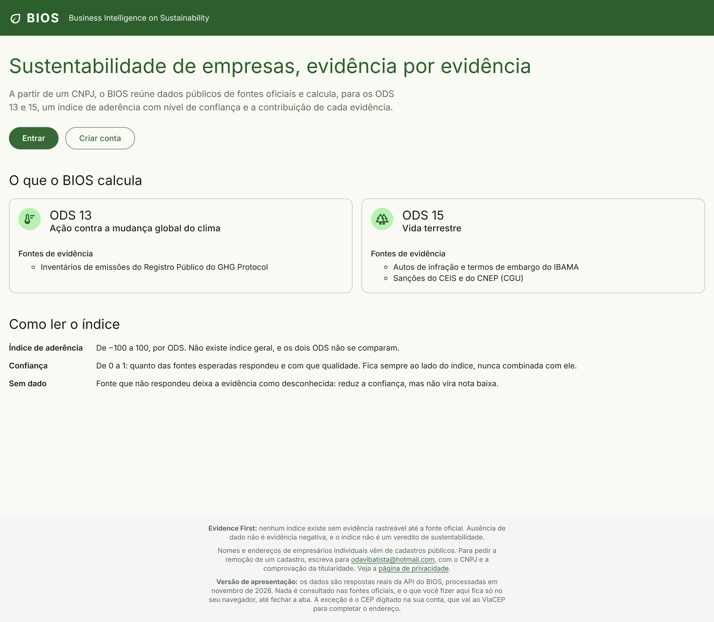

Primeira tela, sem login. Explica em uma frase o que o BIOS faz, quais fontes alimentam cada ODS e como ler o índice e a confiança antes de qualquer consulta. O rodapé fixa o princípio *Evidence First* em todas as telas: ausência de dado não é evidência negativa, e o índice não é veredito de sustentabilidade. A versão de apresentação também tem a entrada direta por `/demonstracao`, usada no QR Code.

**Atende:** [RF01] e [RF02] (entrada para cadastro e login), [IND01], [IND02]. **Casos de uso:** UC01, UC02.

## 9.2 Painel e movimentações recentes

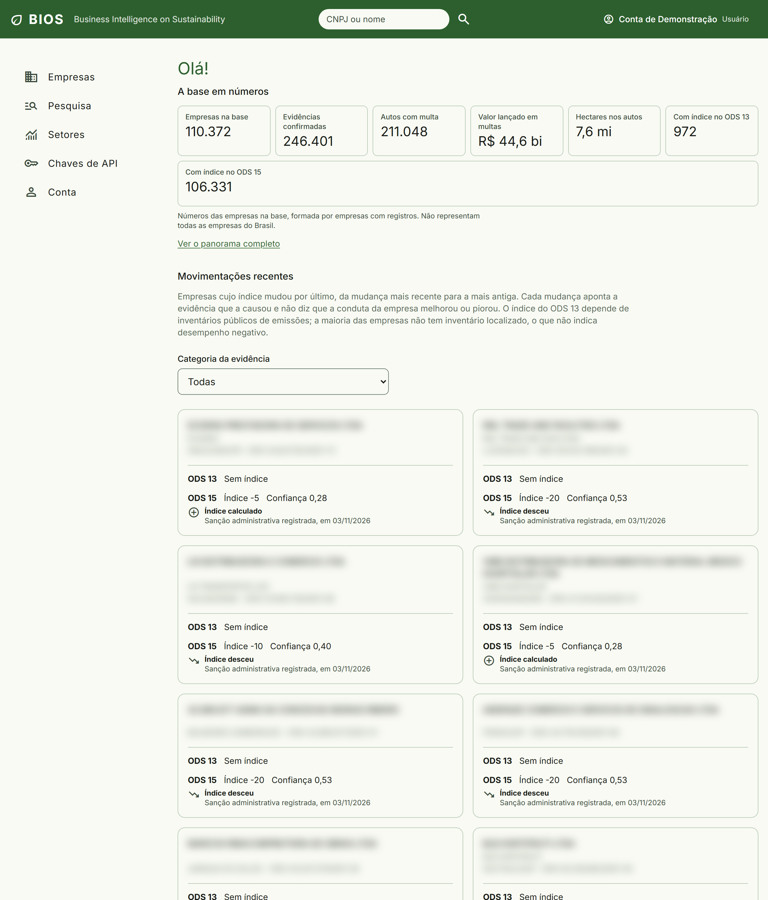

Tela principal depois do login. No alto, os números da base: empresas, evidências confirmadas, autos com multa, valor das multas, área dos autos e quantas empresas têm índice em cada ODS. Abaixo, as empresas cujo índice mudou por último, da mudança mais recente para a mais antiga. Cada card mostra o sentido da mudança, a evidência que a causou e a data, sem tamanho da variação e sem dizer que a conduta melhorou ou piorou. A categoria da evidência filtra a lista.

**Atende:** [RF33], [RF34], [NFDE03], [IND03]. **Caso de uso:** UC18.

## 9.3 Perfil da empresa: índices por ODS

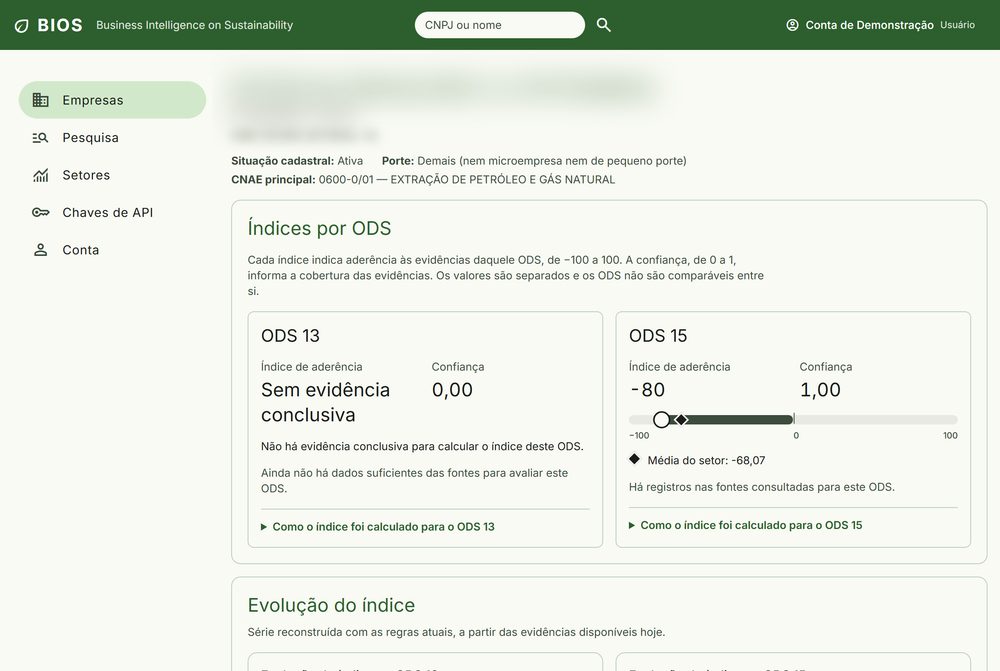

Aberto pela busca do cabeçalho, por CNPJ ou por nome. Mostra situação cadastral, porte e CNAE com a descrição. Os ODS 13 e 15 têm cartões separados, cada um com índice de −100 a 100 e confiança de 0 a 1, lado a lado e nunca combinados. A régua marca a posição da empresa e a média do setor. Sem evidência suficiente, o cartão diz "Sem evidência conclusiva", em vez de mostrar uma nota baixa.

**Atende:** [RF03], [RF04], [RF05], [RF06], [RF10], [RF11], [IND02]. **Casos de uso:** UC06, UC07.

## 9.4 Perfil da empresa: como o índice foi calculado

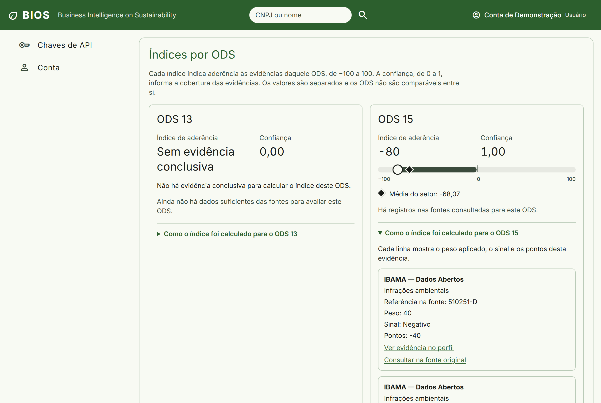

Ao abrir "Como o índice foi calculado", cada evidência que entrou na conta aparece com a fonte, a referência na fonte, o peso, o sinal e os pontos. "Ver evidência no perfil" leva à evidência correspondente, e "Consultar na fonte original" abre o registro no órgão. Empresas com milhares de evidências mostram a lista em trechos de 20.

**Atende:** [RF12], [RF09], [NFCO02]. **Caso de uso:** UC07.

## 9.5 Perfil da empresa: evolução do índice

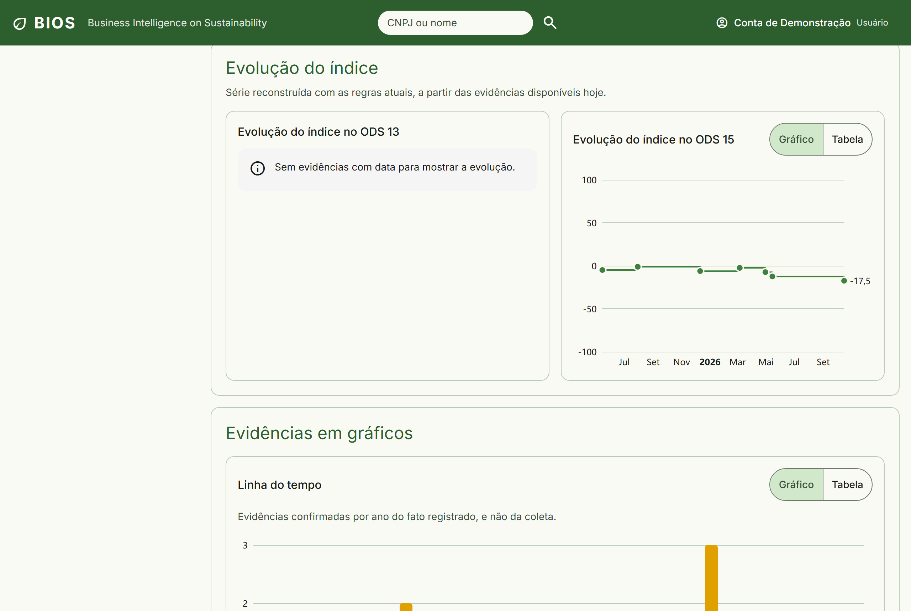

A evolução aparece em degraus: o índice só muda quando chega uma evidência nova, e cada degrau corresponde a uma evidência com data. A tela avisa que a série foi reconstruída com as regras atuais, a partir das evidências disponíveis hoje. Quando não há histórico, como no ODS 13 acima, o cartão explica o motivo. Cada gráfico também pode ser lido como tabela.

**Atende:** [RF36], [IND03], [NFIN04]. **Caso de uso:** UC07.

## 9.6 Perfil da empresa: evidências em gráficos

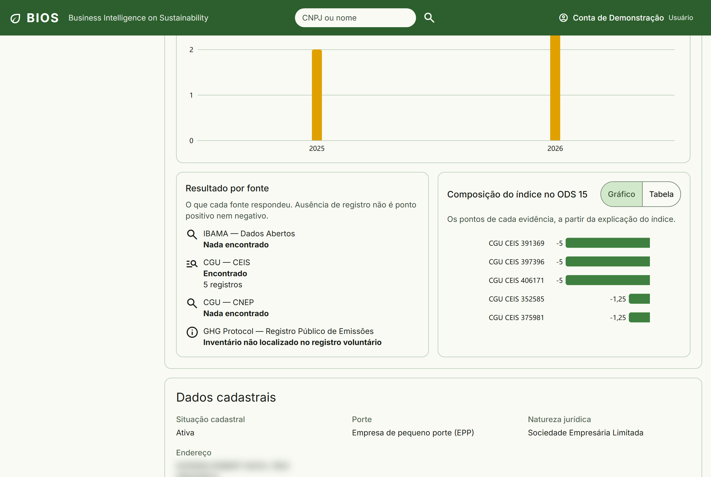

"Resultado por fonte" diz o que cada fonte respondeu, inclusive "Nada encontrado" e "Inventário não localizado", deixando claro que ausência de registro não é ponto positivo nem negativo. "Composição do índice" mostra os pontos de cada evidência que formou o valor. Os demais gráficos do perfil (linha do tempo, tipo de infração, bioma e gravidade) seguem o mesmo padrão: legenda, percentual nas roscas e alternância para tabela.

**Atende:** [RF35], [RF12], [NFCO01], [NFIN01], [IND02]. **Caso de uso:** UC07.

## 9.7 Perfil da empresa: evidências por fonte

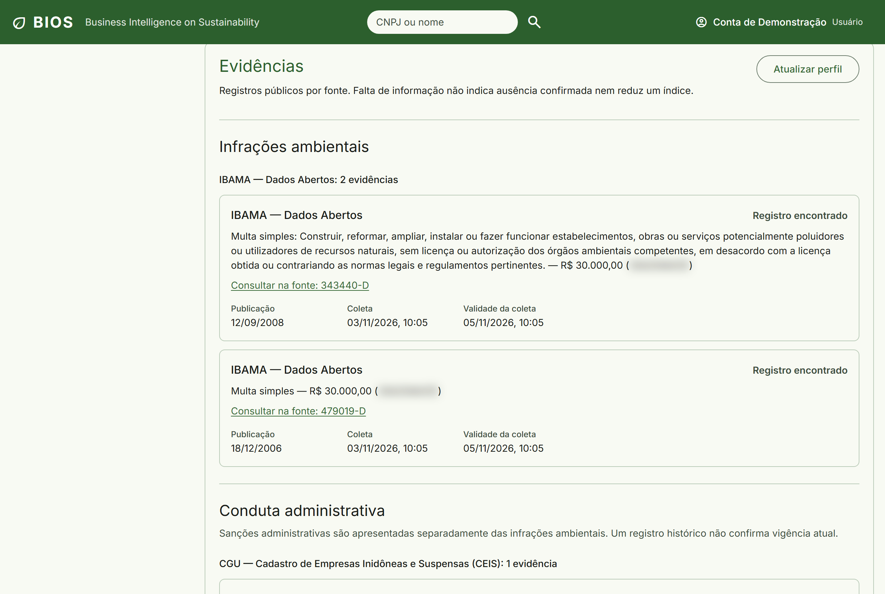

As evidências ficam separadas por categoria: infrações ambientais, conduta administrativa e inventários de emissões. Dentro de cada categoria, ficam agrupadas por fonte. Cada uma traz a descrição, o estado na fonte, o link "Consultar na fonte" e três datas: publicação, coleta e validade da coleta. "Atualizar perfil" pede nova consulta às fontes. Na versão de apresentação, ele informa que nenhuma fonte foi consultada.

**Atende:** [RF07], [RF08], [RF09], [NFIN03]. **Casos de uso:** UC07, UC14.

## 9.8 Pesquisa: panorama de dados

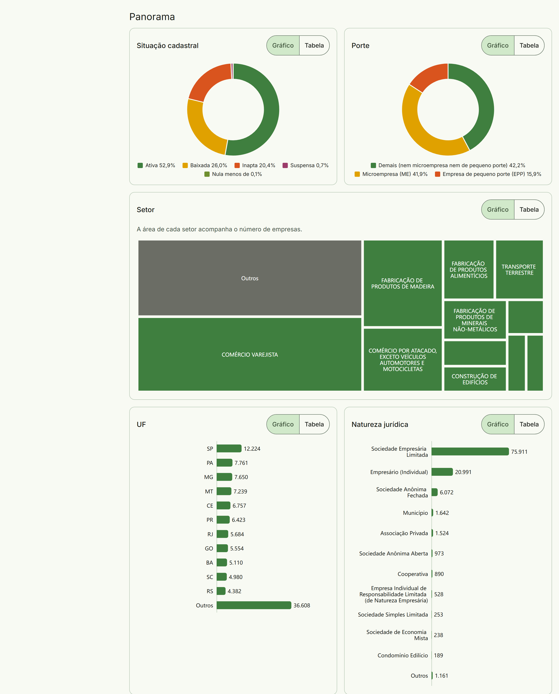

O panorama resume a base inteira, ou só as empresas filtradas, em gráficos: situação cadastral e porte em roscas com percentual, setores num mapa de áreas, e UF, natureza jurídica, bioma, tipo de infração, sanções, evidências por ano e distribuição dos índices e da confiança em barras. As cores seguem a paleta do BIOS, a mesma categoria mantém a cor quando os filtros mudam, e todo gráfico tem tabela equivalente.

**Atende:** [RF37], [RF13], [NFIN01], [NFIN04]. **Caso de uso:** UC19.

## 9.9 Pesquisa: resultados com filtros

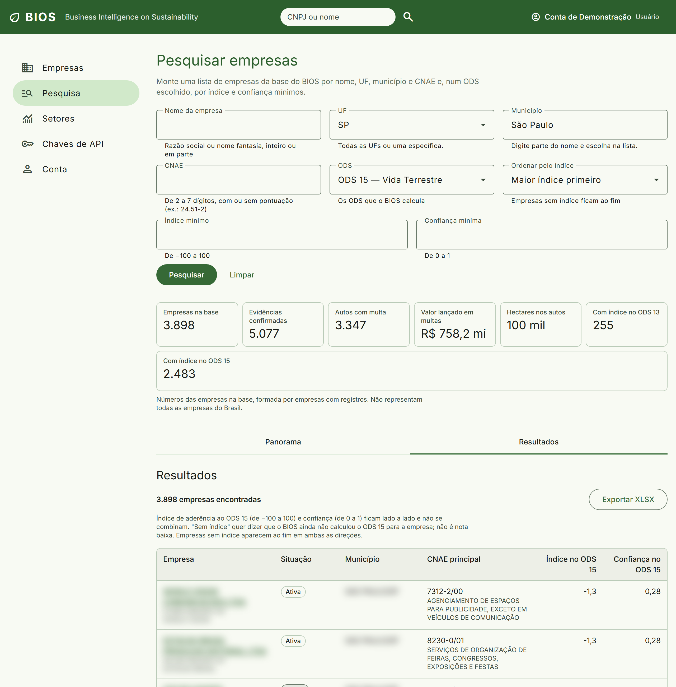

A pesquisa combina nome, UF, município, CNAE, ODS, índice mínimo e confiança mínima. O município só é habilitado depois da UF e vem do catálogo do IBGE, então grafias diferentes chegam ao mesmo lugar. Os totais acompanham o recorte, e a lista pode ser ordenada pelo índice do ODS escolhido, com as empresas sem índice sempre ao fim. "Exportar XLSX" gera a planilha do resultado.

**Atende:** [RF13], [RF14], [RF15], [RF38], [IND02]. **Casos de uso:** UC08, UC09.

## 9.10 Evolução por setor

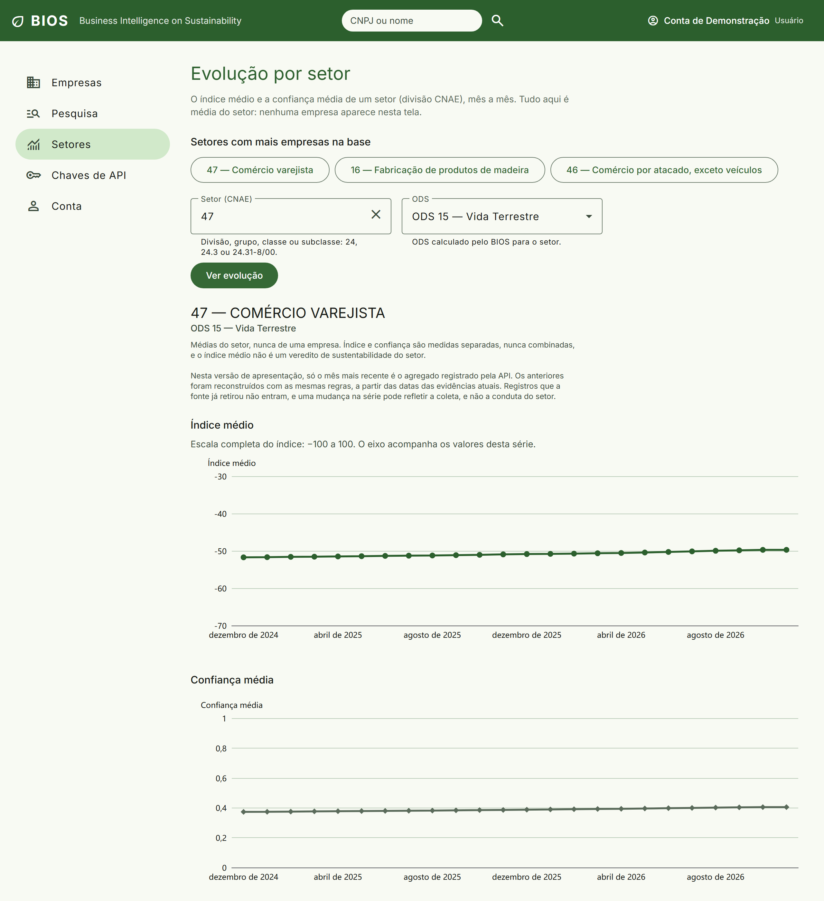

Mostra a média do índice e da confiança de um setor (divisão, grupo, classe ou subclasse CNAE), mês a mês, em dois gráficos separados, com a tabela dos números logo abaixo. Nenhuma empresa aparece nesta tela: a evolução é sempre do setor, como pede o indicador [IA05]. Os setores com mais empresas ficam como atalhos.

**Atende:** [RF30], [IND01], [IND03]. **Caso de uso:** UC10.

## 9.11 Conta: endereço pelo CEP

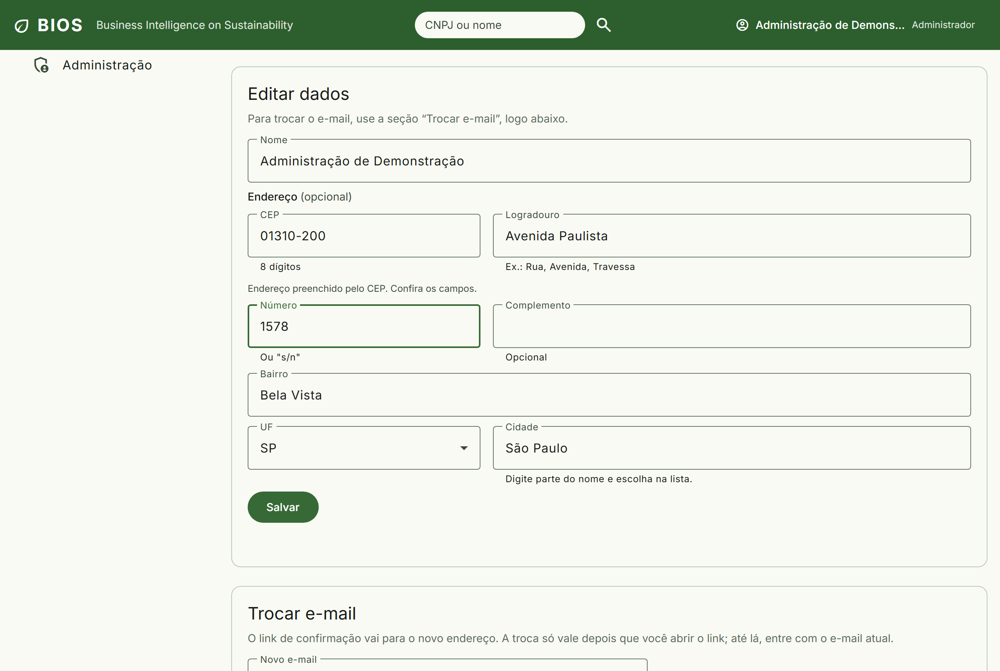

Ao digitar um CEP de 8 dígitos, logradouro, bairro, UF e cidade são preenchidos, e todos continuam editáveis. Número e complemento nunca são preenchidos. A cidade vem do mesmo catálogo de municípios da pesquisa. Se o CEP não existir ou o serviço não responder em 3 segundos, a tela avisa e libera o preenchimento manual.

**Atende:** [RF26], [RF38], [RF39], [NFIN03]. **Caso de uso:** UC05.

## 9.12 Chaves de API

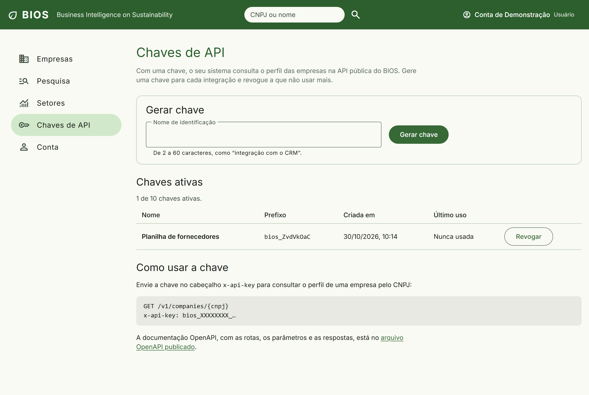

Cada usuário gera uma chave por integração e revoga a que não usar mais. A lista mostra só o prefixo, a data de criação e o último uso: a chave inteira aparece uma única vez, ao ser gerada, e é guardada só como hash. A tela traz o exemplo de chamada e o link para a documentação OpenAPI da API pública.

**Atende:** [RF16], [RF17], [NFSE01], [NFSE04]. **Casos de uso:** UC11, UC12.

## 9.13 Telas no celular

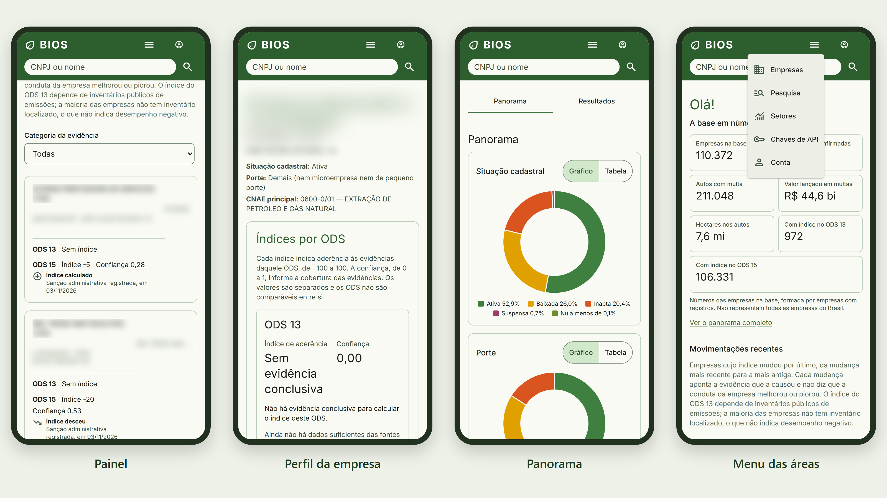

As mesmas telas no celular, sem rolagem horizontal. O cabeçalho mantém a busca visível em todas as rotas, a conta vira um ícone, e as áreas do painel ficam num único menu. Os alvos de toque têm 44 px de altura, os totais passam a duas colunas e a lista de movimentações, a uma. As telas passam pela análise automática de acessibilidade (WCAG 2.2, níveis A e AA) em 1280 e 390 px.

**Atende:** [NFIN01], [NFIN02], [NFIN03].
