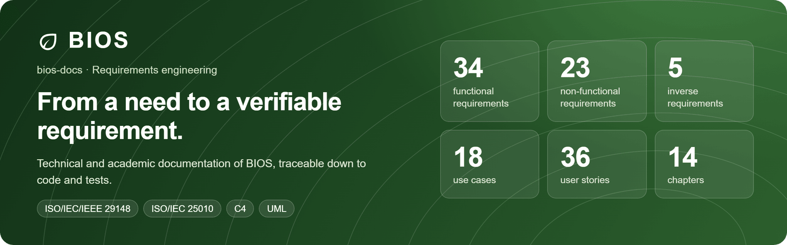
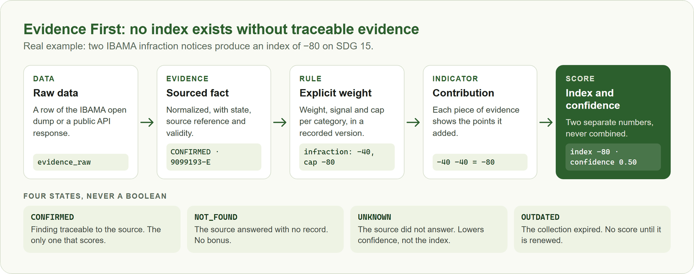
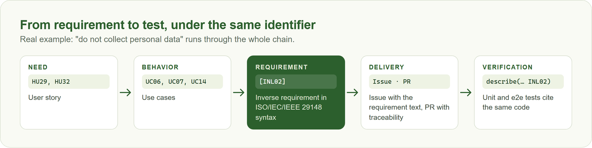
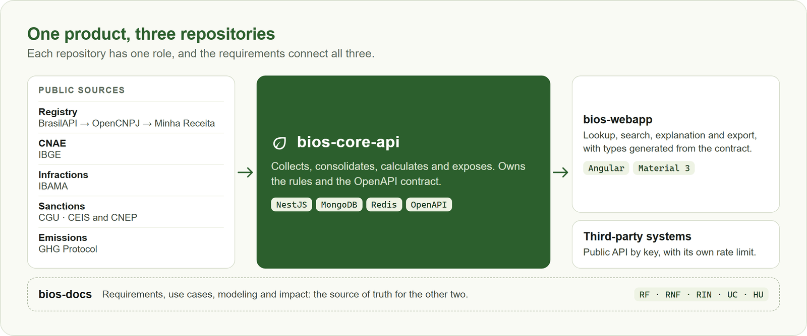

<p align="center">
  
</p>

<p align="center">
  🇧🇷 <a href="README.md">Português</a> · 🇺🇸 <strong>English</strong>
</p>

<p align="center">
  <a href="#abstract">Abstract</a> ·
  <a href="#core-principle-evidence-first">Evidence First</a> ·
  <a href="#inverse-requirements">Inverse requirements</a> ·
  <a href="#method">Method</a> ·
  <a href="#documentation-map">Documentation</a> ·
  <a href="#modeling">Modeling</a> ·
  <a href="#how-to-cite">How to cite</a>
</p>

# BIOS — Business Intelligence on Sustainability

Technical and academic documentation of BIOS, a platform that uses the CNPJ (the Brazilian company tax ID)
as its axis to consolidate public environmental evidence about Brazilian companies and to explain, one
piece of evidence at a time, how each one adheres to the Sustainable Development Goals. The name also
means "life" in Greek.

> The documents themselves are written in Portuguese. This page summarizes them in English.

<table>
  <tr>
    <th align="left">Theme</th>
    <td>Green Agenda Business Intelligence: Active Prospecting and Environmental B2B</td>
  </tr>
  <tr>
    <th align="left">Author</th>
    <td>Davi Deosmar Batista Oliveira Miranda · <a href="https://github.com/odavibatista">GitHub</a> · <a href="https://www.linkedin.com/in/odavibatista/">LinkedIn</a></td>
  </tr>
  <tr>
    <th align="left">Program</th>
    <td>Computer Science, Universidade São Judas Tadeu (USJT), Brazil</td>
  </tr>
  <tr>
    <th align="left">Courses</th>
    <td>Software Engineering · Software Management and Quality (Assessment 3)</td>
  </tr>
  <tr>
    <th align="left">Period</th>
    <td>Second semester of 2026</td>
  </tr>
  <tr>
    <th align="left">Type</th>
    <td>Individual project</td>
  </tr>
  <tr>
    <th align="left">Implementation</th>
    <td><a href="https://github.com/odavibatista/bios-core-api">bios-core-api</a> · <a href="https://github.com/odavibatista/bios-webapp">bios-webapp</a></td>
  </tr>
</table>

## Abstract

Information about the environmental commitment of Brazilian companies is public, but scattered across
agencies and portals with no common lookup key, which makes assessing a company slow, hard to access and
subject to inconsistent interpretation. This work presents BIOS, a platform that integrates registration
data and evidence from IBAMA, CGU and the GHG Protocol by CNPJ and calculates, for SDGs 13 and 15, an
adherence index along with a confidence level. The project adopts the *Evidence First* principle: no index
exists without traceable evidence, and missing data is not treated as negative evidence. Requirements
follow ISO/IEC/IEEE 29148 and quality attributes follow ISO/IEC 25010, including inverse requirements that
forbid verdicts and the collection of personal data. The solution was implemented and verified with
automated tests, and its impact assessment is limited to what the system is able to prove.

**Keywords:** open data; corporate sustainability; Sustainable Development Goals; explainability;
requirements engineering.

## Problem and goal

Anyone who needs to assess a company's socio-environmental profile checks each source by hand and
cross-references the results. Business intelligence tools, in turn, solve the fragmentation by collecting
data about people, a path that carries ethical and privacy risks.

BIOS pursues the same centralization by another route: **public data linked to a CNPJ**, turned into
explainable indicators, to support procurement, sustainability and KYC and KYE review
professionals, researchers, the press and public agencies. Uses include hiring contractors with
their own CNPJ, supporting public procurement, outsourcing and privatization, and choosing partners
that fit a company's environmental culture, always as support for human review. A sole proprietor's public
registered name may contain the owner's name; CPF sequences are masked. The index is neither a
verdict nor an automated decision about a person or company (IND01, INL02).

## Scope

| BIOS does | BIOS does not, by design |
| --- | --- |
| Company lookup by CNPJ or name, with registration data and CNAE | Identify or qualify decision makers at companies |
| Consolidation of positive and negative public evidence | Collect the e-mail, phone or professional profile of individuals |
| Separate index and confidence per SDG, explaining every point | Generate leads or feed pre-sales and sales flows |
| Search, ranking and XLSX export | Integrate with CRMs to export contacts |
| Aggregated sector trends and a public API by key | Claim that a company "is" or "is not" sustainable |

SDGs 13 (Climate Action) and 15 (Life on Land) are the scope of the MVP. SDGs are stored in the database as
their own entity, not hard-coded.

## Core principle: Evidence First

<p align="center">
  
</p>

Two separate numbers support the reading of a result. The **index** says what the evidence indicates.
**Confidence** says how much of the expected sources answered, and with what quality. A high index with low confidence means
little evidence is available, not an absence of practice.

## Inverse requirements

The project treats what the system **must not** do as a first-class requirement:

| ID | Requirement | Effect on the system |
| --- | --- | --- |
| [IND01] | Do not state an absolute sustainability verdict | Only evidence and indexes derived from it; no overall grade |
| [IND02] | Do not turn missing data into negative evidence | `UNKNOWN` lowers confidence, never the index |
| [INL01] | Do not infer the content of a confidential record | A record with no public content is not interpreted |
| [INL02] | Do not collect personal data of individuals linked to the company | Individuals' contacts and profiles are discarded; a CPF in the registered name is masked |

## Method

- **Requirements:** written in ISO/IEC/IEEE 29148:2011 syntax ([Condition] [Subject] [Action] [Object]
  [Constraint]), with an explicit decomposition and links to the use cases.
- **Quality:** non-functional requirements classified by the ISO/IEC 25010:2023 characteristics.
- **Management:** incremental model, suited to a one-person team, with a Kanban board on
  [GitHub Projects](https://github.com/users/odavibatista/projects/15) and labels per test type.
- **Modeling:** UML for use cases, classes and sequences, and the C4 model for the architecture.

<p align="center">
  
</p>

## Documentation map

| Chapter | Content |
| --- | --- |
| [01. Introduction](01-Introdução.md) | Goal, conventions, terms and abbreviations |
| [02. Product and project overview](02-Visão-Geral-do-Produto-e-Projeto.md) | Problem, context, justification and goals |
| [03. Related systems](03-Sistemas-Relacionados.md) | Current situation and existing solutions |
| [04. Actors and user stories](04-Atores-e-Histórias-dos-Usuários.md) | Actors, profiles and 36 user stories |
| [05. Functional requirements](05-Requisitos-Funcionais.md) | 34 requirements and writing heuristics |
| [06. Non-functional requirements](06-Requisitos-Nao-Funcionais.md) | 23 requirements by quality characteristic |
| [07. Inverse requirements](07-Requisitos-Inversos.md) | 5 requirements on what the system must not do |
| [08. Analysis artifacts](08-Artefatos-de-Análise.md) | 18 use cases, classes, sequences, data and C4 |
| [10. Project management](10-Gerenciamento-do-Projeto.md) | Process model, team, schedule and risks |
| [11. Permissions](11-Permissões.md) | Roles and what each one can do |
| [12. References](12-Referências.md) | Standards, data sources and bibliography |
| [13. Tech sheet](13-Ficha-Técnica.md) | Technologies, decisions and accepted risks |
| [14. Design and architecture](14-Projeto-e-Arquitetura.md) | Sources, queues, data layers and categorization |
| [15. Environmental impact](15-Impacto-Ambiental.md) | Indicators and limits of the assessment |
| [16. LGPD assessment](16-Avaliação-LGPD.md) | Personal data, KYC and KYE rules and open items |

## Modeling

<p align="center">
  
</p>

| Artifact | Where |
| --- | --- |
| Use cases, classes and sequences | [08. Analysis artifacts](08-Artefatos-de-Análise.md) |
| C4, level 1 (context) | [Diagram](assets/diagrams/images/bios-context.svg) |
| C4, level 2 (containers) | [Diagram](assets/diagrams/images/bios-architecture.svg) · [editable source](assets/diagrams/bios-c4-architecture.drawio) |
| Data model | [Diagram](assets/database/bios-database.svg) · [DBML](assets/database/bios-database.dbml.txt) |

## Impact assessment

BIOS measures the reach and quality of the transparency it creates, with five indicators: companies looked
up, volume of evidence, geographic concentration, coverage per source and the evolution of the average index
**per sector**, never per individual company.

The work is explicit about what it does **not** measure: actual reduction of environmental harm, sector
improvement that may merely reflect better collection (instrumentation bias) and decisions made outside the
platform. The system does not claim an impact it cannot prove. Details in
[15. Environmental impact](15-Impacto-Ambiental.md).

## Implementation

| Repository | Content | Verification |
| --- | --- | --- |
| [bios-core-api](https://github.com/odavibatista/bios-core-api) | API in NestJS, MongoDB and BullMQ | 3,193 unit tests, 1,022 e2e, 99.71% of lines |
| [bios-webapp](https://github.com/odavibatista/bios-webapp) ([demo](https://bios-webapp.vercel.app/)) | Angular interface | 741 unit tests, 140 e2e, 98.43% of lines |

## How to cite

**ABNT:**

> MIRANDA, Davi Deosmar Batista Oliveira. **BIOS**: Business Intelligence on Sustainability. 2026.
> Trabalho acadêmico (Graduação em Ciência da Computação) – Universidade São Judas Tadeu, São Paulo,
> 2026. Disponível em: https://github.com/odavibatista/bios-docs.

**BibTeX:**

```bibtex
@misc{miranda2026bios,
  author       = {Miranda, Davi Deosmar Batista Oliveira},
  title        = {{BIOS}: Business Intelligence on Sustainability},
  year         = {2026},
  howpublished = {Academic work, Universidade São Judas Tadeu},
  url          = {https://github.com/odavibatista/bios-docs}
}
```

The **Cite this repository** button on GitHub uses the [`CITATION.cff`](CITATION.cff) file.

## License

© 2026 Davi Deosmar Batista Oliveira Miranda. All rights reserved. This repository is public for
reference and academic assessment; copying, modifying, distributing or using the material requires the
author's permission. See [LICENSE](LICENSE).
