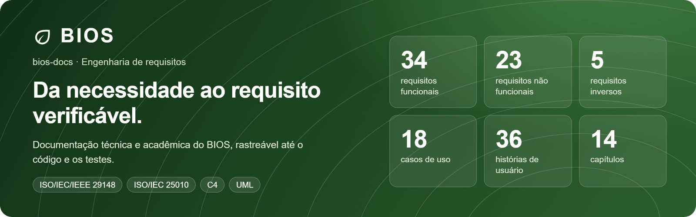
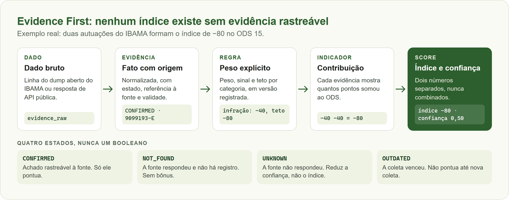
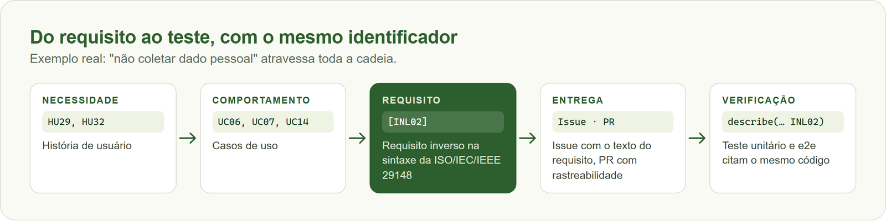
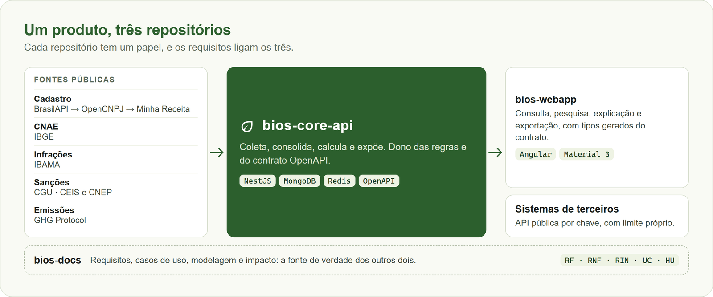

<p align="center">
  
</p>

<p align="center">
  🇧🇷 <strong>Português</strong> · 🇺🇸 <a href="README.en.md">English</a>
</p>

<p align="center">
  <a href="#resumo">Resumo</a> ·
  <a href="#princípio-central-evidence-first">Evidence First</a> ·
  <a href="#requisitos-inversos">Requisitos inversos</a> ·
  <a href="#método">Método</a> ·
  <a href="#mapa-da-documentação">Documentação</a> ·
  <a href="#modelagem">Modelagem</a> ·
  <a href="#como-citar">Como citar</a>
</p>

# BIOS — Business Intelligence on Sustainability

Documentação técnica e acadêmica do BIOS, uma plataforma que usa o CNPJ como eixo para consolidar
evidências ambientais públicas de empresas brasileiras e explicar, evidência por evidência, a aderência
de cada uma aos Objetivos de Desenvolvimento Sustentável. O nome também significa "vida", em grego.

<table>
  <tr>
    <th align="left">Tema</th>
    <td>Inteligência Comercial de Agenda Verde: Prospecção Ativa e B2B Ambiental</td>
  </tr>
  <tr>
    <th align="left">Autor</th>
    <td>Davi Deosmar Batista Oliveira Miranda · <a href="https://github.com/odavibatista">GitHub</a> · <a href="https://www.linkedin.com/in/odavibatista/">LinkedIn</a></td>
  </tr>
  <tr>
    <th align="left">Curso</th>
    <td>Ciência da Computação, Universidade São Judas Tadeu (USJT)</td>
  </tr>
  <tr>
    <th align="left">Disciplinas</th>
    <td>Engenharia de Software · Gestão e Qualidade de Software (Avaliação 3)</td>
  </tr>
  <tr>
    <th align="left">Período</th>
    <td>Segundo semestre de 2026</td>
  </tr>
  <tr>
    <th align="left">Natureza</th>
    <td>Projeto individual</td>
  </tr>
  <tr>
    <th align="left">Implementação</th>
    <td><a href="https://github.com/odavibatista/bios-core-api">bios-core-api</a> · <a href="https://github.com/odavibatista/bios-webapp">bios-webapp</a></td>
  </tr>
</table>

## Resumo

Informações sobre o comprometimento ambiental de empresas brasileiras são públicas, mas estão dispersas
entre órgãos e portais sem chave comum de consulta, o que torna a avaliação de uma empresa lenta, pouco
acessível e sujeita a interpretações inconsistentes. Este trabalho apresenta o BIOS, plataforma que
integra dados cadastrais e evidências do IBAMA, da CGU e do GHG Protocol por CNPJ e calcula, para os
ODS 13 e 15, um índice de aderência acompanhado de nível de confiança. O projeto adota o princípio
*Evidence First*: nenhum índice existe sem evidência rastreável, e a ausência de dado não é tratada como
evidência negativa. Os requisitos seguem a ISO/IEC/IEEE 29148 e os atributos de qualidade, a ISO/IEC
25010, incluindo requisitos inversos que proíbem vereditos e a coleta de dados pessoais. A solução foi
implementada e verificada com testes automatizados, e sua avaliação de impacto se limita ao que o
sistema consegue comprovar.

**Palavras-chave:** dados abertos; sustentabilidade corporativa; Objetivos de Desenvolvimento
Sustentável; explicabilidade; engenharia de requisitos.

## Problema e objetivo

Quem precisa avaliar o perfil socioambiental de uma empresa consulta cada fonte manualmente e cruza os
resultados por conta própria. As ferramentas de inteligência comercial, por sua vez, resolvem a dispersão
coletando dados de pessoas, um caminho com riscos éticos e de privacidade.

O BIOS busca a mesma centralização por outro caminho: **dados públicos vinculados ao CNPJ**,
transformados em indicadores explicáveis, para apoiar profissionais de compras, de sustentabilidade,
de verificação em KYC e KYE, pesquisadores, imprensa e órgãos públicos. Os usos incluem contratar
prestadores PJ, apoiar licitações, terceirizações e privatizações e escolher parceiros alinhados à
cultura ambiental de uma empresa, sempre como apoio à análise humana. A razão social
pública de empresário individual pode conter o nome do titular; sequências de CPF são mascaradas.
O índice não é veredito nem decisão automática sobre uma pessoa ou empresa ([IND01], [INL02]).

## Escopo

| O BIOS faz | O BIOS não faz, por decisão de projeto |
| --- | --- |
| Consulta de empresa por CNPJ ou nome, com dados cadastrais e CNAE | Identificar ou qualificar tomadores de decisão nas empresas |
| Consolidação de evidências públicas positivas e negativas | Coletar e-mail, telefone ou perfil profissional de indivíduos |
| Índice e confiança separados, por ODS, com explicação de cada ponto | Gerar leads ou alimentar fluxos de pré-vendas e vendas |
| Pesquisa, ranking e exportação em XLSX | Integrar com CRMs para exportar contatos |
| Evolução agregada por setor e API pública por chave | Afirmar que uma empresa "é" ou "não é" sustentável |

Os ODS 13 (Ação Contra a Mudança Global do Clima) e 15 (Vida Terrestre) são o recorte do MVP. Os ODS
ficam no banco como entidade própria, não fixados em código.

## Princípio central: Evidence First

<p align="center">
  
</p>

Dois números separados sustentam a leitura do resultado. O **índice** diz o que as evidências indicam. A
**confiança** diz quanto das fontes esperadas respondeu e com que qualidade. Índice alto com confiança baixa significa poucas
evidências disponíveis, não ausência de prática.

## Requisitos inversos

O projeto trata como requisito de primeira classe aquilo que o sistema **não deve** fazer:

| ID | Requisito | Efeito no sistema |
| --- | --- | --- |
| [IND01] | Não afirmar veredito absoluto de sustentabilidade | Só evidências e índices derivados delas; nenhuma nota geral |
| [IND02] | Não converter ausência de dado em evidência negativa | `UNKNOWN` reduz a confiança, nunca o índice |
| [INL01] | Não inferir conteúdo de registro sigiloso | Registro sem teor público não é interpretado |
| [INL02] | Não coletar dado pessoal de indivíduo vinculado à empresa | Contatos e perfis de indivíduos são descartados; CPF na razão social é mascarado |

## Método

- **Requisitos:** redigidos na sintaxe da ISO/IEC/IEEE 29148:2011 ([Condição] [Sujeito] [Ação] [Objeto]
  [Restrição]), com decomposição explícita e ligação com os casos de uso.
- **Qualidade:** requisitos não funcionais classificados pelas características da ISO/IEC 25010:2023.
- **Gestão:** modelo incremental, adequado a uma equipe de um integrante, com quadro Kanban no
  [GitHub Projects](https://github.com/users/odavibatista/projects/15) e etiquetas por tipo de teste.
- **Modelagem:** UML para casos de uso, classes e sequência, e modelo C4 para a arquitetura.

<p align="center">
  
</p>

## Mapa da documentação

| Capítulo | Conteúdo | Seção da A3 |
| --- | --- | --- |
| [01. Introdução](01-Introdução.md) | Objetivo, convenções, termos e abreviações | Introdução |
| [02. Visão geral do produto e projeto](02-Visão-Geral-do-Produto-e-Projeto.md) | Problema, contexto, justificativa e objetivos | Problema, Contexto, Justificativa, Objetivos |
| [03. Sistemas relacionados](03-Sistemas-Relacionados.md) | Situação atual e soluções existentes | Contexto de mercado |
| [04. Atores e histórias dos usuários](04-Atores-e-Histórias-dos-Usuários.md) | Atores, perfis e 36 histórias de usuário | Stakeholders |
| [05. Requisitos funcionais](05-Requisitos-Funcionais.md) | 34 requisitos e heurísticas de redação | Engenharia de Requisitos |
| [06. Requisitos não funcionais](06-Requisitos-Nao-Funcionais.md) | 23 requisitos por característica de qualidade | Engenharia de Requisitos |
| [07. Requisitos inversos](07-Requisitos-Inversos.md) | 5 requisitos do que o sistema não deve fazer | Engenharia de Requisitos |
| [08. Artefatos de análise](08-Artefatos-de-Análise.md) | 18 casos de uso, classes, sequência, dados e C4 | Modelagem |
| [10. Gerenciamento do projeto](10-Gerenciamento-do-Projeto.md) | Modelo de processo, equipe, cronograma e riscos | Gerenciamento do Projeto |
| [11. Permissões](11-Permissões.md) | Papéis e o que cada um pode fazer | Adaptado, simplificado |
| [12. Referências](12-Referências.md) | Normas, fontes de dados e bibliografia | Referências |
| [13. Ficha técnica](13-Ficha-Técnica.md) | Tecnologias, decisões e riscos aceitos | Complementa Projeto e Arquitetura |
| [14. Projeto e arquitetura](14-Projeto-e-Arquitetura.md) | Fontes, filas, camadas de dados e categorização | Projeto e Arquitetura |
| [15. Impacto ambiental](15-Impacto-Ambiental.md) | Indicadores e limites da avaliação | Impacto Ambiental |
| [16. Avaliação de LGPD](16-Avaliação-LGPD.md) | Dados pessoais, regras de KYC e KYE e pendências | Engenharia de Software |

## Modelagem

<p align="center">
  
</p>

| Artefato | Onde |
| --- | --- |
| Casos de uso, classes e sequência | [08. Artefatos de análise](08-Artefatos-de-Análise.md) |
| C4, nível 1 (contexto) | [Diagrama](assets/diagrams/images/bios-context.svg) |
| C4, nível 2 (contêineres) | [Diagrama](assets/diagrams/images/bios-architecture.svg) · [fonte editável](assets/diagrams/bios-c4-architecture.drawio) |
| Modelo de dados | [Diagrama](assets/database/bios-database.svg) · [DBML](assets/database/bios-database.dbml.txt) |

## Avaliação de impacto

O BIOS mede o alcance e a qualidade da transparência que gera, com cinco indicadores: empresas consultadas,
volume de evidências, concentração geográfica, cobertura por fonte e evolução do índice médio **por
setor**, nunca por empresa isolada.

O trabalho é explícito sobre o que **não** mede: a redução real de dano ambiental, a melhoria de um setor
quando ela pode refletir apenas melhor coleta (viés de instrumentação) e decisões tomadas fora da
plataforma. O sistema não reivindica impacto que não consegue comprovar. Detalhes em
[15. Impacto ambiental](15-Impacto-Ambiental.md).

## Implementação

| Repositório | Conteúdo | Verificação |
| --- | --- | --- |
| [bios-core-api](https://github.com/odavibatista/bios-core-api) | API em NestJS, MongoDB e BullMQ | 3.193 testes unitários, 1.022 e2e, 99,71% das linhas |
| [bios-webapp](https://github.com/odavibatista/bios-webapp) ([demonstração](https://bios-webapp.vercel.app/)) | Interface em Angular | 741 testes unitários, 140 e2e, 98,43% das linhas |

## Como citar

**ABNT:**

> MIRANDA, Davi Deosmar Batista Oliveira. **BIOS**: Business Intelligence on Sustainability. 2026.
> Trabalho acadêmico (Graduação em Ciência da Computação) – Universidade São Judas Tadeu, São Paulo,
> 2026. Disponível em: https://github.com/odavibatista/bios-docs.

**BibTeX:**

```bibtex
@misc{miranda2026bios,
  author       = {Miranda, Davi Deosmar Batista Oliveira},
  title        = {{BIOS}: Business Intelligence on Sustainability},
  year         = {2026},
  howpublished = {Trabalho acadêmico, Universidade São Judas Tadeu},
  url          = {https://github.com/odavibatista/bios-docs}
}
```

O botão **Cite this repository**, no GitHub, usa o arquivo [`CITATION.cff`](CITATION.cff).

## Licença

© 2026 Davi Deosmar Batista Oliveira Miranda. Todos os direitos reservados. Este repositório é
público para consulta e avaliação acadêmica; copiar, modificar, distribuir ou usar o material depende
de autorização do autor. Veja [LICENSE](LICENSE).
